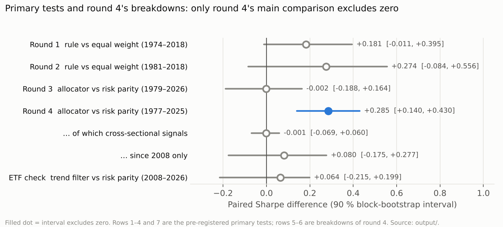
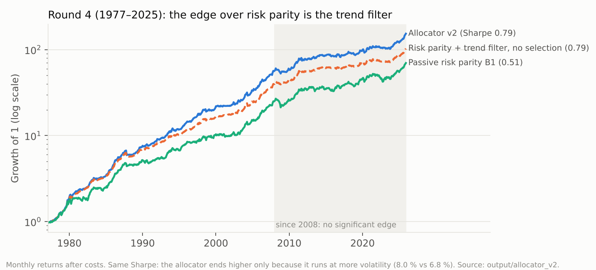

# rotationlab – which asset class next month? Five pre-registered research rounds and a live forecast

*Nima Rotzer · BSc Mathematics, ETH Zürich · built Oct 2026*

In plain words: a program that, every month, ranks stocks, bonds, gold and silver by how likely they are to do well
next month – and a careful, documented attempt to find out whether such rankings actually work.

**The question.** At every month-end, which asset classes are relatively attractive for the next month – and can
that be shown honestly, out of sample, after costs?

**The short answer.** A monthly ranking of US equities, Treasuries, gold and silver runs live since October 2026.
Its historical edge (rank IC +0.10, 1973–2018) did **not** replicate in a held-out period (2019–2025). Across five
research rounds, each fixed in writing before its data was evaluated, exactly one pre-registered primary criterion
passed: risk parity with a 12-month trend filter beats passive risk parity, 1977–2025. Ablations show where that comes from –
the trend filter, not the cross-sectional signals – and that it is not significant since 2008, neither on research
indices nor on tradable ETFs. The project's result is a documented negative: careful testing, nothing overstated.
(That round's two secondary signal tests also passed as stand-alone rank portfolios; they add nothing to the book.)
Two later questions were pre-registered the same way: adding the Fed's decision variables (rate changes, real policy
rate, inflation, unemployment, curve) made the ranking *worse* in-sample; and a leveraged long-short on the ranking
(rank 1 long 1.5×, last rank short 1.5×) was profitable in-sample only, with an −82 % drawdown.



## Results at a glance

| Round | What was tested | Data | Pre-registered criterion | Result |
|---|---|---|---|---|
| 1 | Composite of momentum, trend, low volatility ranks 4 classes | 1973–2018 + holdout 2019–25 | rank IC > 0 in-sample **and** in holdout | IC +0.098 [+0.051, +0.141] in-sample; **holdout −0.03** (83 months) – not replicated |
| 1 | Paper portfolio: top 2, trend filter, 10 % vol target | 1974–2018 | Sharpe above equal weight, interval > 0 | +0.18 [−0.01, +0.39] – missed |
| 2 | + carry and value, 5 classes | 1981–2018 + holdout | as round 1 | IC +0.056 [−0.002, +0.106]; holdout IC −0.16 – missed |
| 3 | Sleeve allocator: industries, Treasuries, metals | 1979–2026 | Sharpe above passive risk parity, interval > 0 | −0.002 [−0.19, +0.16] – not established |
| 4 | Five sleeves, ≈ 45 instruments (industries, 21 countries, Treasuries, 9 currencies, metals) | 1977–2025 | as round 3 | **+0.285 [+0.14, +0.43] – met** |
| 4 | … ablation: same book without cross-sectional selection | 1977–2025 | reported | allocator − ablation **−0.001 [−0.07, +0.06]**: the edge is the trend filter |
| 4 | … since 2008 | 2008–2025 | reported | +0.08 [−0.18, +0.28] |
| ETF | Round 4's ablation with tradable ETFs (sector SPDRs, EFA, SHY/IEF, GLD/SLV) | 2008–2026 | filter vs. no filter, interval > 0 | +0.06 [−0.21, +0.20] – not met; tracks the index study (ρ = 0.96) |
| 5 | Round-1 composite + Fed category (rate decisions, real policy rate, inflation, Sahm indicator, curve), per-class ridge on the expanding past | 1978–2018 + 2019–25 (seen) | rank-IC gain > 0 in-sample **and** > 0 in 2019–25 | **−0.058 [−0.108, −0.006]** – worse in-sample; +0.07 in 2019–25 – not established |
| L/S | Rank 1 long 1.5×, last rank short 1.5×, held unless the ranking changes, with borrow, financing and costs | 1974–2018 + 2019–25 (seen) | Sharpe > 0 in-sample (interval) **and** in 2019–25 | +0.31 [+0.05, +0.52], drawdown −82 %; 2019–25 −0.24 – in-sample only |
| L/S stop | The same, closed and reopened every month, 20 % stop on daily closes (both legs out) | 1974–2018 + 2019–25 (seen) | as L/S | +0.11 [−0.20, +0.32], drawdown −99 % – not established; the stop does not help (Δ −0.06) |

Intervals are 90 % moving-block bootstrap (block 12) of paired monthly differences. Every trial ever run on this
history is counted in a register (`docs/TRIALS.yaml`, N = 82); the deflated Sharpe probability (Bailey & López de
Prado) is 0.56 / 0.84 / 0.22 for rounds 1–3 (computed when the register held 58 trials) and 0.895 for round 4 (70);
with today's register of 82 round 4 stands at 0.82, the long-short rules at 0.03 or less – none reaches 0.95. Round 4's passive risk parity is the
weakest of its four baselines (Sharpe 0.51 vs. equal weight 0.61, 60/40 0.56); against equal weight and 60/40 the
allocator's interval includes zero, and since 2008 it trails both (0.59 vs. 0.72).



## What runs live

`.github/workflows/daily.yml` ingests prices and macro data every weekday into a point-in-time store and, after each
month-end, writes the round-1 ranking for the next month: rank, probability of finishing in the top half, trend per
class. Forecasts and their outcomes go into an append-only, hash-chained journal (branch `data`,
`journal/forecast/`); its head is anchored outside the repo (branch `anchors`), so a forecast cannot be changed after
the fact. The report is `reports/forecast/latest.md` on branch `data`. The first counted decision is 2026-10-31,
written on Monday 2026-11-02.
Since the same decision a second forecast runs next to it – round 5's model with the Fed category, in its own journal
and anchor (`journal/forecast_fed/`, `reports/forecast_fed/`). It was put live by decision before its test, and the
test did not support it; the published forecast stays round 1 (ADR 063/064).

**How much can a live record prove?** Monthly rank ICs scatter with a standard deviation of 0.64. Even if the true IC
were the in-sample 0.098, about 10 years of live months would be needed for t = 1.65, and about 22 years for 80 %
power. The live track demonstrates an honest, tamper-evident process; it will not be statistical evidence soon.

## What I take away

1. **A strong backtest is the starting point, not the result.** Round 1 passed every in-sample test and failed the
   held-out period.
2. **Ablations decide what a result means.** Round 4 "worked", but the same book without its signals worked equally
   well – the signals added complexity, not Sharpe.
3. **Count every trial.** Four rounds on one history are a multiple-testing problem; the register and the deflated
   Sharpe make that visible instead of hiding it.
4. **Check the research data against tradable instruments.** The ETF rebuild tracks the index study closely
   (ρ = 0.96); the post-2008 period is where both lose the edge.
5. **A convincing story is not forecasting power.** Some of the Fed model's slopes read like a textbook (a higher real
   policy rate favours Treasuries over silver), others flip sign between fits; together they rank next month no better
   than chance – and diluting momentum with them cost IC.
6. **Leverage does not create return, and a stop does not tame it.** The long-short rule earns 9.3 % a year at 1.5×
   and at 1.0× alike, and loses 82 % at its worst; closing it every month with a 20 % stop made it worse (costs of
   6.8 % a year, stops that sell silver spikes at the top). The stop test also surfaced a data error – a Saturday
   silver print in 1983 – reported next to the pre-registered run rather than quietly fixed.
7. **Rebuild the headline independently.** A short pandas version (`examples/trend_filter_from_scratch.py`)
   reproduces the engine (Sharpe 0.79 vs. 0.80, ρ = 0.98) – after finding a pandas alignment bug in the rebuild itself.

## Method

- **Pre-registration:** each round's rules, data, baselines, criterion and variants are written down (`docs/ADR.md`)
  and merged before the evaluation runs; nothing is changed afterwards. Emergencies follow pre-written rules
  (e.g. ADR 059: a FRED series vanished – decided before any data was seen).
- **Point-in-time data:** every observation carries its publication (vintage) date; a decision at date D sees only
  what was known at D. One stated convention: research returns that are computable from public prices on their date
  (Kenneth French industry and country portfolios) carry no publication lag, although French publishes them weeks
  later; the tradable ETF check uses real closing prices instead. Look-ahead is tested by mutating the future and
  checking that no decision changes.
- **Execution and costs:** trades at the next session after the decision, per-instrument costs, financing of leverage.
- **Statistics:** paired block bootstrap for Sharpe differences, Newey-West t-tests for signal portfolios, Holm
  correction across signals, minimum detectable effect, deflated Sharpe against the full trial register.
- **Engineering:** one engine for backtest and live, golden tests that pin every published number, 392 unit and
  integration tests plus 28 golden tests, ruff, mypy strict, CI on every pull request.

Notes on each method in plain language: `docs/METHODS.md`. Two-page summary: `docs/WRITEUP.md`.
Interview questions and honest answers: `docs/INTERVIEW.md`.

## Reproduce

```bash
uv sync --extra dev                                      # or: pip install -e ".[dev]"
python -m rotationlab.cli ingest --full --provider static   # research history into the local store (≈ 20 s)
python scripts/allocator_v2_walkforward.py                 # round 4 (≈ 30 min) → output/allocator_v2/
python examples/trend_filter_from_scratch.py               # independent rebuild of round 4's headline (≈ 10 s)
python scripts/round5_fed.py                               # round 5, Fed category, pointwise (≈ 2 min) → output/forecast_fed/
python scripts/long_short_check.py                         # leveraged long-short on the ranking (≈ 5 s) → output/long_short/
python scripts/long_short_stop.py                          # the same, monthly reopen + 20 % stop on daily closes → output/long_short_stop/
python -m rotationlab.cli golden --strategy sleeve_allocator_v2   # reproduces 0.7911 / 10.83 % / −13.09 %
pytest                                                     # 420 tests, about 12 min (golden tests included)
```

Each output folder names its script (`output/README.md`); the reports inside are written in German. The ETF check needs the live store of branch `data`
(`python scripts/etf_check.py --store <checkout>/data/store --data-commit <sha>`).

## Repository map

| path | content |
|---|---|
| `rotationlab/data/` | point-in-time store, providers (FRED, Yahoo, Stooq, BLS, CFTC, French, Shiller), quality checks |
| `rotationlab/forecast/` | the live model, journal with hash chain, evaluation statistics |
| `rotationlab/strategies/`, `engine/`, `portfolio/` | strategy modules of all rounds, the engine, costs and book |
| `scripts/` | one script per study; `output/` holds what they wrote |
| `configs/` | every parameter, including each round's pre-registered configuration |
| `docs/` | decision log (`ADR.md`, German), acceptance protocols, reviews, trial register, methods, write-up |

The first exploratory code (Oct 2026) lives on branch `archive/legacy-research`; the package reproduces its formulas
to 1e-9 (`tests/fixtures/legacy_reference/`).

## How this was built

I set the questions, the goals and the standard, and made the decisions recorded as mine in the decision log (for
example ADR 059 and the live/no-live calls). The code and documents were written with Claude (Anthropic) as an AI
coding and research assistant, and every result was checked by an independent review pass before it was accepted
(`docs/REVIEW_ALLOKATOR.md`). The detailed logs are in German: decision log `docs/ADR.md`, acceptance protocols
`docs/FORECAST_ABNAHME.md`, full status `docs/STATUS_DE.md`.

Paper trading only; nothing here is investment advice.
