# Architektur: rotationlab

Ein System, das laufend Marktdaten verarbeitet, Szenarien bewertet, Handelssignale erzeugt und Zusammenhänge quantifiziert – mit einem einzigen Code-Pfad für Backtest und Live-Betrieb.

Stand 2026-10-25 (Phase 1 und Phase 2 gebaut). Entscheidungen mit Begründung: `docs/ADR.md`. Betrieb: `docs/RUNBOOK.md`. Datenherkunft: `data/DATA_SOURCES.md`. Abnahme Phase 1: `docs/PHASE1_ABNAHME.md`.

---

## 1. Zielbild und Leitprinzipien

`rotationlab` ist ein Python-Paket, das täglich Markt- und Makrodaten einliest, daraus monatlich Zielgewichte für ein Cross-Asset-Portfolio ableitet, das aktuelle Portfolio gegen definierte Szenarien bewertet, die Zusammenhänge zwischen Assets und Treibern laufend neu misst und jedes Signal in einem Paper-Trading-Journal festhält. Es handelt nicht selbst; es sagt, was zu tun wäre, und beweist später, ob es recht hatte.

Fünf Module, nach Bedeutung gewichtet: **US-Aktien-Exposure** (wie viel Aktien: Trend/Momentum, optional Bewertung), **US-Sektor-Rotation** (welche Branchen: Momentum + Trend, Markt-Trendfilter), Multi-Asset-Rotation (Aktien vs. Anleihen vs. Rohstoffe), Rohstoff-Trend und **Edelmetalle** (Gold/Silber-Mean-Reversion plus Crash-Hedge in einem Satelliten). US-Aktien tragen 60 % des Risikobudgets, weil sie in jedem Portfolio den grössten Teil des Risikos ausmachen. Neue Module kommen über dieselbe Schnittstelle dazu.

**Zehn Grundsätze:**

1. **Ein Code-Pfad.** Backtest, Walk-forward und Live laufen durch dieselbe Engine. Live ist ein Backtest, dessen Uhr auf heute steht.
2. **Point-in-time.** Jede Beobachtung trägt `obs_date` (wofür sie gilt) und `vintage_date` (ab wann sie bekannt war). Eine Abfrage „Stand 30.06.2008“ liefert nur, was damals wissbar war.
3. **Features sind reine Funktionen** `MarketView → Zahlen`, ohne I/O und Zustand; jedes besteht automatisch einen Look-ahead-Test.
4. **Strategien sind austauschbare Module** mit einem Vertrag: Datenstand + eigener Zustand hinein, `Proposal` heraus. Kein Modul kennt ein anderes.
5. **Portfolio und Risiko sind eine eigene Schicht.** Module schlagen vor, die Risikoschicht entscheidet; sie läuft täglich, Signale monatlich.
6. **Alles deklarativ und reproduzierbar.** YAML-Konfiguration; jeder Lauf schreibt einen Run-Record mit Git-SHA, Config-Hash und Datenstand.
7. **Golden Tests schützen die Forschung.** Die Studien-Kennzahlen (Aktien-Exposure Sharpe 0.573, Sektor-Rotation 0.591, Multi-Asset 0.57, Rohstoff-Trend 0.74, Gold/Silber-MR 0.22, Hedge 8/8 Crashes) sind Referenzwerte.
8. **Forschung und Produktion sind getrennt.** `research/` importiert aus dem Paket, nie umgekehrt.
9. **Kostenlose Daten, austauschbare Provider.** Yahoo, FRED/ALFRED, CFTC, LBMA, World Bank.
10. **Das Journal ist Teil des Systems.** Jedes Live-Signal mit Datum und Referenzkurs; nach einem Jahr existiert ein echter Out-of-sample-Nachweis.

---

## 2. Gesamtarchitektur

```mermaid
flowchart TD
    Y[Yahoo Finance<br/>ETFs, Futures, VIX, DXY] --> S
    F[FRED / ALFRED<br/>Makro mit Vintages] --> S
    C[CFTC<br/>Positionierung] --> S
    L[LBMA · World Bank<br/>statische Historie] --> S
    S[Ingest + Qualitätschecks → Point-in-time-Store<br/>Append-only-Log CSV.gz + Manifest · series, obs_date, vintage_date, value]
    S --> V[MarketView.as_of D<br/>nur obs_date ≤ D und vintage_date ≤ D]
    V --> FE[Feature-Registry · reine Funktionen · Look-ahead-Test]
    FE --> S1[US-Aktien-Exposure 0.35]
    FE --> S2[US-Sektor-Rotation 0.25]
    FE --> S3[Multi-Asset-Rotation 0.25]
    FE --> S4[Rohstoff-Trend 0.10]
    FE --> S5[Edelmetalle 0.05]
    S1 & S2 & S3 & S4 & S5 --> CB[Combiner<br/>Risikobudget je Modul, Konfidenz skaliert]
    CB --> R[Risikoschicht täglich<br/>Vol-Ziel · Limits · Stops · Kill-Switch · Kosten]
    R --> E[Engine: ein Loop<br/>backtest · walkforward · live]
    E --> J[Journal]
    E --> RP[Report · Dashboard · Telegram]
    E --> SC[Szenarien]
    E --> RL[Zusammenhänge]
```



Daten fliessen von oben nach unten; jede Schicht hängt nur von der direkt darüber ab. Die Trennlinie zwischen Store und `MarketView` ist entscheidend: oberhalb gibt es Zeit und I/O, unterhalb nur einen eingefrorenen Datenstand. Deshalb können Features, Strategien und Risikoregeln reine Funktionen sein, und deshalb ist der Backtest derselbe Loop über 640 historische Datenstände statt über einen heutigen.

---

## 3. Datenschicht

Die Datenschicht beantwortet eine Frage korrekt: *Was war am Tag D bekannt?* Stand: **gebaut und optimiert (Phase 1)**: 182 Tests (+ Netzwerk- und Replay-Tests), Abdeckung 97 % (`core/` und `data/view.py` 100 %), ruff und mypy strict ohne Befund.

### 3.1 Konventionen (ADR 021, 022)

| Begriff | Regel |
|---|---|
| `obs_date` | **Ende** der Periode, für die der Wert gilt (Monatswert September → 2026-09-30, egal wie der Provider stempelt) |
| `vintage_date` | ab wann der Wert öffentlich war; jede Zeile trägt beide Daten |
| Lag `"<n>D"` | n Kalendertage nach `obs_date` (Marktdaten `0D`, H.15/ICE `1D`, CFTC `7D`) |
| Lag `"<n>M"` | Kalender-Monatsende n Monate nach dem Beobachtungsmonat; bei Entscheidungen an Monatsenden exakt gleich `shift(n)` der Studien |
| Entscheidungsdatum | **Kalender**-Monatsende D; Ausführung zum Schlusskurs der nächsten Sitzung (`Clock.execution_day`) |
| Vintage-Prinzip | Ein Wert ist datiert, wann ein *Live-System* dieselbe Information hätte haben können. Renditen und Durchschnitte öffentlicher Preise (French-Portfolios, World-Bank-Monatsmittel, Monatsmittel von Zinsen, Shiller-Preis, Dollar-Indizes) → `0D`. Statistiken, die nur ihr Herausgeber kennt (Aktivität, Arbeitsmarkt, Preise, Geldmenge, S&P-Gewinne, ICE-Spreads, CFTC) → Publikationslag bzw. echte ALFRED-Vintages |

Korrektur gegenüber dem Entwurf: French-Renditen hatten 35 Tage Lag (hätte die Aktien-Goldens um einen Monat verschoben), Shiller-Gewinne 120 Tage (widerspricht dem Audit, richtig sind 6 Monate).

### 3.2 Point-in-time-Store (ADR 020)

Append-only-Log unter `data/store/` (Branch `data`), keine Binärabhängigkeit:

```
manifest.json                 Dateien mit Zeilenzahl und SHA-256, Ingest-Zustand je Reihe, Quell-Fingerprints
observations/base-*.csv.gz    kompaktierte Historie
observations/delta-*.csv.gz   je Ingest-Lauf eine Datei: nur neue Beobachtungen und Revisionen
series.csv                    Katalog mit Abdeckung (für Menschen und DuckDB)
quality_log.csv  ingest_log.csv  quarantine/
```

Primärschlüssel `(series_id, obs_date, vintage_date)`; doppelte Schlüssel → spätere `ingested_at` gewinnt (Korrektur, bevor jemand sie sehen konnte). Dateien deterministisch (sortiert, `%.17g`, gzip ohne Zeitstempel) → gleiche Daten, gleiche Prüfsumme. `store verify` prüft Hashes, Zeilenzahlen, verwaiste Dateien, `vintage ≥ obs`. Grösse: 285 655 Zeilen statische Historie = 3 MB; ein täglicher Lauf fügt Kilobytes hinzu. DuckDB liest das Log direkt: `SELECT * FROM read_csv('data/store/observations/*.csv.gz')` mit `AS_OF_SQL` (`data/view.py`).

**Diff-Regeln beim Ingest** (`PointInTimeStore.diff`):

| Fall | Neue Zeile |
|---|---|
| echte Vintages (ALFRED) | jeder unbekannte Schlüssel; geänderter Wert bei bekanntem Schlüssel = Archivkorrektur |
| neue Beobachtung, Erstladung einer Reihe | `vintage = Lag(obs)` – die Historie, die ein Backtest braucht |
| neue Beobachtung, pünktlich | `vintage = Lag(obs)` |
| neue Beobachtung, verspätet (> Lag + 5 Tage: gefüllte Lücke, verspätete Veröffentlichung, eigener Ausfall) | `vintage = Ingest-Tag` – der Store behauptet nie, die Pipeline habe etwas früher gewusst |
| geänderter Wert (stille Revision, Split) | `vintage = max(Ingest-Tag, Lag(obs))`, alte Zeile bleibt |
| neue Beobachtung im Lauf, der ein Symbol rebasiert (Split) | `vintage = max(Ingest-Tag, Lag(obs))` – kein Sichtdatum mischt alte Basis der Historie mit neuer Basis der letzten Sitzungen (ADR 034) |
| gleicher Wert (relative Toleranz, Yahoo 1e-6) | nichts |

Splits: Yahoo rebasiert die ganze Historie; ein Inkrement-Fenster mit Split-Ereignis wird auf die volle Historie erweitert, eine gleichförmige Reskalierung der gespeicherten Historie löst ebenfalls einen Voll-Abruf aus – sonst entstünde ein künstlicher Sprung am Fensteranfang. Alle Zeilen des Symbols aus diesem Lauf (Kurse, Dividenden, Splits) tragen den Ingest-Tag; die Sicht am Split-Tag selbst zeigt die alte Basis ohne die letzte Sitzung statt eines −50-%-Artefakts (getestet).

**As-of-Abfrage.** Jede Zeile gilt für Wissensdaten in `[vintage_date, nächste vintage_date)`. `PitIndex` (`data/pit.py`) beantwortet `as_of(series, D)` aus numpy-Arrays: O(log n) für Reihen ohne Revisionen, eine Maske sonst. Gegen `as_of_pandas` (die SQL-Semantik) mit Zufallshistorien getestet.

### 3.3 Serienkatalog

`configs/series.yaml` (explizit: FRED, BLS, Shiller, Yahoo-Futures/Indizes, French live, CFTC) + aus `universe.yaml` abgeleitet (ETF-Schlusskurse, Dividenden, Splits) + eingebauter Katalog des Static-Providers (185 Reihen der Forschungshistorie, 126 Echtzeit-FRED-MD-Reihen) = **477 Reihen**. `rotationlab validate` prüft: jede referenzierte Reihe existiert, Ketten sind homogen (Frequenz, Niveau vs. Wert), Rollen haben die richtige Art, jedes Asset hat eine Total-Return-Quelle.

**Makroketten** (ADR 030): virtuelle Reihen `macro:CPI`, `macro:CORE_CPI`, `macro:UNRATE`, `macro:PAYEMS` (FRED/ALFRED, dann BLS) und `macro:SP_EARNINGS`, `macro:SP_PRICE`, `macro:SP_CPI` (Shiller live, dann der eingefrorene Spiegel). Features lesen `view.series("macro:CPI")`; die zweite Quelle füllt nur Monate, die der ersten fehlen, `view.chain_provenance()` zeigt, welche.

### 3.4 Provider

`Provider.fetch_frame(spec, since) -> DataFrame[obs_date, vintage_date, value]`; zustandslos; Transport (`providers/http.py`, stdlib, Retries mit Backoff, Mindestabstand, API-Key-Schwärzung) getrennt vom Parsen.

| Provider | Reihen | Vintages | Inkrement |
|---|---|---|---|
| `static` | `data/raw`: FRED-MD (126), French FF3/FF5+Mom/10 Branchen, Shiller, LBMA, S&P-TR täglich, VIX, HY-OAS, Dollar, World Bank; Konstrukte GOLD, TBILL, UST1/5/10, USD_IDX, FF_* | Lag-Modell nach Vintage-Prinzip | nur bei geändertem Fingerprint der Rohdateien |
| `yahoo` | ETFs (close, dividend, split), GC/SI/CL/HG=F, ^GSPC, ^VIX, DX-Y.NYB | `0D` | 10 Tage vor letzter Beobachtung; Split → volle Historie |
| `stooq` | ETF-Schlusskurse als zweite Quelle (Kette, Quellenabgleich) | `0D` | 10 Tage |
| `fred` | 12 Makroreihen mit ALFRED, Zinsen/Spreads täglich, Monatsmittel | ALFRED (`realtime_start`), sonst Lag | ALFRED: Perioden mit Start nach letztem Abruf − 7 Tage (API kappt ältere Perioden auf den Start → würden Vintages fälschen) |
| `french` | Live-Kopien der French-Dateien (Monitoring, Drift) | `0D`, Revisionen bei CRSP-Update | ganze Dateien |
| `cftc` | COT legacy: Netto-Positionierung Gold, Silber, Kupfer, WTI, S&P | `7D` | 21 Tage |
| `bls` | CPI, Kern-CPI, Arbeitslosenquote, Beschäftigung (zweite Quelle der Makroketten) | `1M` | 10-Jahres-Fenster, JSON-POST |
| `shiller` | `ie_data.xls`: Preis, Dividenden, Gewinne, CPI, 10y, CAPE (Live-CAPE; Spiegel endet 2023-06) | `0D`/`1M`/`6M` wie statisch | ganze Datei, URLs konfigurierbar |
| `static` (Echtzeit) | `static:fredmd_rt:*` aus archivierten FRED-MD-Vintages (`data/raw/fredmd_vintages`) | Datum der Vintage-Datei | eine Zeile je Wertänderung |

ALFRED: Beobachtungen, deren erste archivierte Vintage weit nach dem Lag liegt (Archiv beginnt für viele Reihen in den 1990ern), bekommen eine zusätzliche Zeile am Lag-Datum mit dem ältesten archivierten Wert (Rest-Risiko: nicht der Erstwert); Veröffentlichungen vor Periodenende (vorläufige Michigan-Werte) gelten am Periodenende. **Ohne API-Key werden ALFRED-Reihen übersprungen, nie mit dem Lag-Modell gefüllt** – revidierte Werte mit Erstveröffentlichungsdatum würden sich sonst mit echten Vintages mischen.

### 3.5 Qualitätschecks

| Check | Regel | Folge |
|---|---|---|
| Schema (vor dem Store) | endlich; `obs ≤ Lauftag`; `vintage ≥ obs`; Preise > 0; Dividende ≥ 0; Rendite in (−100 %, +500 %]; Rendite­einheit in [−10, 100] % | Zeile in Quarantäne, **blocking**; laufende Sitzung still verworfen |
| Aktualität | täglich: ≤ 2 Sitzungen hinter der letzten abgeschlossenen (NYSE); wöchentlich/monatlich: Lag + 3 Perioden | Pflichtreihe (Schlusskurs handelbarer Assets) **blocking**, sonst warn |
| Lücken | fehlende NYSE-Sitzungen (2 Jahre live, ab 1971 statisch), Werte an Nicht-Sitzungen | warn > 3; kein Forward-Fill im Store |
| Ausreisser | Tages-Log-Rendite > 8 σ (250 Tage) in den letzten 30 Tagen | warn, beide bleiben |
| Revision | Preis ändert sich > 0.5 %; gleichförmige Reskalierung = Split/Adjustierung | warn bzw. ok mit Faktor |
| Quellenabgleich | Yahoo vs. Stooq Tagesrenditen > 1 % auseinander | warn |
| TR vs. Preis | TR-Rendite < Preisrendite | **blocking** wenn neu, warn wenn historisch (S&P-Rekonstruktion vor 1990: 110 Tage, max. −0.26 %) |
| Verspätung | neue Beobachtung > Lag + 5 Tage | warn, datiert auf Ankunft |
| Revisionshäufung | ≥ 5 Revisionen gespeicherter Preise in 7 Tagen (Splits ausgenommen), jede einzeln unter 0.5 % | warn: Provider instabil? |

Jedes Ergebnis landet in `quality_log.csv`; ein blocking Ergebnis → Exit-Code 3.

### 3.6 MarketView

```python
view = factory.at(D)
view.series(series_id, freq=None|"D"|"ME"|"QE")    # as-of, Monatslabel = Kalender-Monatsende (≤ D)
view.panel(series_ids, freq="ME")
view.asset_series(asset, role)                       # Rolle aus universe.yaml, Kette gespleisst
view.close(assets, lookback_days=None)
view.total_return(assets, freq="ME")                 # aus total_return | return | close+dividend | yield
view.returns(assets, freq="ME")
view.provenance(asset, role)                         # welche Quelle für welchen Zeitraum, Skalierung
view.last_obs(series_id)                             # für Kill-Switch und Report
```

Garantien (getestet): kein Index > D (Monat, in dem D liegt, wird mit D beschriftet); jede Zeile mit `vintage_date ≤ D`; gleicher D + gleicher Datenstand ⇒ bitidentisch; Aufrufer können den Cache nicht verändern. **Ketten** (`[primär, Ersatz]`): Ersatzquelle nur, wo die primäre keine Daten hat (Historie davor, Ausfall danach); Niveaus per Verhältnis am Übergang, Zinsen/Renditen per Wert. **Cash** aus der Monatsrendite: Monat t verdient y(t−1)/1200 (wie die Studien); täglich gleichmässig über die Sitzungen des Monats verteilt, Monatsenden identisch.

`view_factory(bundle, store, providers=["static"])` liefert das eingefrorene Golden-Panel, unabhängig von späteren Live-Daten.

**Leistung** (ADR 028): Für Reihen ohne Revisionen ist die Antwort an D die ersten k Zeilen der ganzen Historie; Monats- und Quartalswerte und Total-Return-Indizes werden deshalb einmal berechnet und je Datum nur abgeschnitten. Gegen den Referenzpfad bitidentisch getestet (81 Stichtage × 8 Reihen × 10 Assets × 3 Frequenzen); 612 Monatsenden × 6 Assets + 1 Makroreihe in 2.1 s statt 4.9 s, der Rest ist pandas-Overhead.

### 3.7 Kalender (ADR 023)

Eigener regelbasierter NYSE-Kalender (Feiertagsregeln inkl. Beobachtungsregeln, Juneteenth ab 2022, Wahltage bis 1980, Sonderschliessungen 1972–2025), gültig ab 1971. Abgleich mit 55 Jahren S&P-500-Schlusskursen: **0 Abweichungen** in beide Richtungen.

### 3.8 Echtzeit-Makrohistorie (ADR 029)

Die Studien rechnen mit heutigen, revidierten Makrodaten und einem Monat Verzögerung. Wie gross der Unterschied zu dem ist, was damals bekannt war, misst `scripts/revision_study.py` an echten FRED-MD-Vintages (`output/revisions/REPORT.md`). Im Repo liegen drei echte Vintages (2019-09, 2021-04, 2026-10, Herkunft in `vintages.yaml`); `rotationlab fredmd-archive` holt das ganze Archiv (monatlich seit 1999-08), wo die St. Louis Fed erreichbar ist.

| Befund (Stichprobe 2019-09 und 2021-04 gegen 2026-10) | Wert |
|---|---|
| Industrieproduktion: mittlere Revision der Jahresrate am Rand (letzte 24 Monate) | 0.9–1.1 Pkt (max 1.9) |
| Realeinkommen am Rand | 0.4–1.2 Pkt (max 2.6) |
| CPI am Rand | 0.03 Pkt |
| Studien-Regime (Wachstum × Inflation) gleich: ganze Historie / letzte 24 Monate | 98–99 % / 83–88 % |

Die Regime weichen gerade dort ab, wo Live-Entscheidungen fallen. `static:fredmd_rt:*` liefert deshalb eine echte Echtzeit-Historie, getrennt von `static:fredmd:*` (Forschungsparität), damit sich beide nie mischen; live kommen echte ALFRED-Vintages dazu.

### 3.9 Betrieb und Beobachtung

| Werkzeug | Zweck |
|---|---|
| `rotationlab store health --days 30` | Verlauf statt Momentaufnahme: Läufe, Abruffehler, neue/revidierte/verspätete Werte je Provider, Befunde je Check, offene Punkte des letzten Laufs |
| `rotationlab record-fixtures` | zeichnet echte Antworten aller Provider auf (`RecordingClient`); `tests/integration/test_recorded.py` spielt sie offline ab (`ReplayClient`). Wöchentlich im Workflow `network`, Ergebnis im Branch `recorded-fixtures` |
| `rotationlab fredmd-archive` | lädt fehlende FRED-MD-Vintages (historisches Zip und Monatsdateien, mehrere URL-Muster), überschreibt nie; Workflow `fredmd-archive` |
| `pytest -m network` | Formatprüfung gegen die echten Dienste, FRED-Echtzeitorakel für die ALFRED-Logik |

---

## 4. Feature-Schicht

Reine Funktionen, registriert mit Metadaten (`core/registry.py`).

| Art | Signatur | Rückgabe |
|---|---|---|
| `CrossSectionFeature` | `(view, assets) -> Series` | ein Wert je Asset |
| `StateFeature` | `(view) -> float \| str \| Series` | Zustand der Welt |

**Definition über die Panel-Formel** (ADR 036, `features/_define.py`): Ein Feature ist eine vektorisierte Rechnung `compute(panel, **params)` auf dem *as-of-Panel* (was der View bei D weiss, auf einem vollständigen Monatsraster bis zum Monat von D; der laufende Monat trägt das Label D). Der punktweise Wert bei D ist die letzte Zeile derselben Rechnung, Panel ≡ punktweise gilt also per Konstruktion und wird trotzdem für alle Features geprüft. Auf Reihen ohne Revisionen und Lag ist das einmal auf dem Endstand gerechnete Panel an jedem D bitidentisch zum punktweisen Wert (gleitende Fenster sehen nur ein Präfix derselben Daten) – das macht Forschung auf Panels schnell.

```python
def _trend10(panel):                                   # panel = Monats-TR-Niveaus, Spalten = Assets
    """Distance to the 10-month average."""
    return panel / panel.rolling(10).mean() - 1

define("trend_10m", "cross_section", ["total_return"], Months(10), tr_panel_input, _trend10)
feature("trend_10m").call(view, ["SPY", "GLD"])      # → Series je Asset, NaN ohne Wert im Monat von D
```

Parameter sind deklariert (`params` mit Vorgaben); `FeatureMeta.call` lehnt alles andere ab. Strategien lesen Features nur über die Registry. Verschiebungen im Feature (`shift(1)` für den CPI) rekonstruieren das Timing der Studien für *vergangene* Zeilen und sind höchstens so lang wie der Publikations-Lag im Store; ist ein Wert verspätet, steht bei D NaN, nie ein zukünftiger Wert. Ergebnisse werden je View gecacht (Kopien).

**Katalog (33 Features):**

| Modul | Features |
|---|---|
| `price` (Querschnitt) | `mom_3_1` `mom_6_1` `mom_12_1` (1-Monats-Skip) · `mom_12` · `trend_10m` · `vol_12m` · `inv_vol_12m` · `drawdown` · `excess_mom_12m` (Parameter `cash`) |
| `equity` | `cape` · `excess_cape_yield` · `ecy_percentile` (Shiller über die Makroketten; Gewinne 6M, CPI 1M) |
| `macro` | `growth_dir` · `inflation_dir` · `quadrant` · `commodity_state` · `sahm` · `d_real_yield_3m` · `d_log_usd_3m` · `d_cpi_yoy_3m` · `credit_spread` · `d_credit_3m` · `d_curve_3m` · `d_fedfunds_3m` · `tips_real_10y` · `breakeven_10y` |
| `risk_appetite` | `risk_appetite` · `risk_appetite_pct` (expandierende z-Scores ab 1970-12, wie DERISK.md) |
| `ratio` | `gs_ratio` · `gs_ratio_z60` · `gs_ratio_z120` · `gs_ratio_mom12` · `gs_hedge_ratio` (auf XAU/XAG) |
| `positioning` | `cot_spec_net_z` (CFTC wöchentlich; im Forschungspanel leer) |

Markt-Trend und Markt-Momentum sind `trend_10m` und `excess_mom_12m` auf dem Markt-Asset; Faktor-Renditen kommen mit `relationships/` (Phase 3).

**Look-ahead-Test** (`tests/lookahead/harness.py`): Feature bei D auf dem vollen Store berechnen; Store mit randomisierten Werten für `obs_date > D` oder `vintage_date > D` erneut; Ergebnisse müssen bitidentisch sein. Abnahme Phase 2: alle 33 Features, alle fünf Module und der Walk-forward auf dem echten Forschungspanel an 13 Stichtagen (7 Stress, 6 zufällig), Leck-Kontrollen für Feature und Strategie greifen.

**Verboten im Feature:** Querschnitts-Normierung (macht die Strategie), Forward-Fill über die eigene Frequenz hinaus, Zugriff auf Store oder Konfiguration, undeklarierte Parameter.

---

## 5. Strategie-Module

```python
class Strategy(Protocol):
    spec: StrategySpec
    def warmup(self) -> Months
    def initial_state(self) -> StrategyState
    def propose(self, view: MarketView, state: StrategyState) -> tuple[Proposal, StrategyState]
```

`Proposal` = Gewichte auf Modulkapital (long-only Summe ≤ 1; long-short netto ≈ 0, brutto ≤ 2; Overlay relativ zum Kern-Exposure), Konfidenz 0..1, Horizont, Diagnostik, `StopRule`s, Notizen. Deterministisch. `StrategyState` ist serialisierbar (JSON im Run-Record), live aus dem Journal rekonstruiert.

**Stop-Regeln** werden von der Risikoschicht täglich geprüft: `StopRule(kind, scope, threshold, action)`; Beispiel Gold/Silber `ratio_drawdown −15 % → close`.

| Modul | Budget | Rolle | Signal | Konfidenz | Golden |
|---|---|---|---|---|---|
| `us_equity_exposure` | 0.35 | Kern | Mittel aus Trend (10M) und Momentum (12M Überschuss) → 0, ½ oder 1 in SPY, Rest T-Bills; Bewertung (ECY) optional als Skalierung 0.75–1 | Einigkeit der Signale | Sharpe 0.573, MDD −41 % (1927–2026; B&H 0.45, −84 %) |
| `us_sector_rotation` | 0.25 | Kern | Rang-Composite (12-1 50 %, 6-1 30 %, Trend 20 %) über 11 Sektor-SPDRs, Top-3 gleichgewichtet, ganze Hülle in Cash bei Markt unter 10M-Schnitt | Score-Streuung | Sharpe 0.591, MDD −46 % (1928–2026, French-Branchen) |
| `multi_asset_rotation` | 0.25 | Kern | z-Composite (3-1 20 %, 6-1 30 %, 12-1 30 %, Trend 20 %, inverse Vol 10 %; ADR 035), Top-3 inverse Vol, Trendfilter je Pick | Score-Streuung | Sharpe 0.57 (Walk-forward OOS 0.772) |
| `commodity_trend` | 0.10 | Kern | nur Aufwärtstrends, inverse Vol, kein Tilt | Anteil im Aufwärtstrend | Sharpe 0.74 |
| `precious_metals` | 0.05 | Satellit, L/S | Gold/Silber-Ratio: clip(−z60/2, ±1) in 6M-Tranchen + Crash-Hedge-Anteil (Basis 0.25, voll bei tiefer Ratio und hohem Risikoappetit); Stop Ratio −15 % | \|z60\| | MR Sharpe 0.22; Hedge 8/8 Crashes; Kombination gemessen: 0.11 (ADR 040, offen) |

Bewusst **nicht** in den Modulen (Research `output/equity/REPORT.md`, Audit `docs/AUDIT_equity_study.md`): Arbeitslosigkeit und Kreditspreads als Aktien-Risiko-Signale (keine 1M-Prognosekraft, Arbeitslosigkeit sogar gegenläufig; als Gate verwässern sie den Trend-Ausstieg), Branchen-Regime-Tabellen als Signal (Defensive gewinnen in Rezessionen nicht), Faktor-Rotation (long-short, ETF-Historie erst ab 2013; wird in `relationships/` gemessen), Midterm-Zyklus (24 Beobachtungen; nur Kontext im Report).

`WalkForward(strategy, grid, refit_every=12, min_train=120)` ist selbst eine Strategy und kapselt die Parameterwahl ohne Zukunftsblick (ADR 039): alle Gitterpunkte laufen als Schattenportfolios mit, gewählt wird der beste Sharpe (netto, ex Cash) auf allen bisherigen Monaten.

**Bau aus der Konfiguration:** `build_strategy(bundle, id, "live" | "long_history")`. Das Universum ist risikobehaftete Assets plus genau ein Cash-Asset (`asset_class: cash`), das Modul bekommt es als `params["cash"]`; der Rest jedes Vorschlags ist Cash. `long_history_params` überschreiben Parameter für das Forschungsuniversum (Markt `FF_MKT` statt `SPY`, Handel in `XAU/XAG` statt `GLD/SLV`).

---

## 6. Portfolio und Risiko

### Combiner (monatlich)
Risikobudgets `b_i` statt Kapitalquoten. Je Modul: ex-ante Vol aus EWMA-Kovarianz (Halbwertszeit 60 Tage, Floor 5 %); Skalierung `b_i · σ_target/σ_i · (c_min + (1−c_min)·confidence)`, `c_min = 0.5`; Summe; Overlays additiv relativ zum Kern-Aktien-Exposure (Limit 0.3); Portfolio auf `σ_target = 10 %`, `max_gross = 1.5`. Startbudgets: US-Aktien-Exposure 0.35, US-Sektor-Rotation 0.25, Multi-Asset 0.25, Rohstoff-Trend 0.10, Edelmetalle 0.05 (`configs/portfolio.yaml`). Kein Overlay-Modul in v1.

### Risikoregeln (täglich, in dieser Reihenfolge)

| Regel | Prüfung | Aktion |
|---|---|---|
| Positionslimit | Asset ≤ 35 %, Klasse ≤ 60 %, Brutto ≤ max_gross | kürzen |
| Modul-Stops | alle `StopRule`s | close / halve / flag |
| Portfolio-Drawdown | > 12 % vom Hoch | Exposure halbieren bis < 6 % |
| Vol-Spike | 20-Tage-Vol > 2 × Ziel | auf Ziel skalieren |
| Daten-Kill-Switch | Pflichtreihe > 3 × Frequenz alt oder blocking | **keine neuen Trades**, Alarm |
| Trend-Bruch | Asset unter 10M-Schnitt zwischen Entscheidungstagen | flag |

### Kosten und Book (gebaut in Phase 2)
`CostModel`: bp je Seite auf gehandeltem Gewicht je Asset (`cost_bps` aus `universe.yaml` oder ein Satz für alle), Cash-Bein optional (`cash_bps`, nur für die Kostenkonvention mancher Studien), Leihkosten p.a. auf Shorts je Kalendertag. `Book`: Bestände in Einheiten der Total-Return-Indizes, Cash in Einheiten des Cash-Assets, Shorts negativ (Erlös im Cash); `rebalance` handelt von den gedrifteten auf die Zielgewichte und zahlt die Kosten aus dem Vermögen; `apply(RiskAction)` schliesst, halbiert oder skaliert (für Phase 3). Combiner in Phase 2: `SingleStrategy` (ein Modul allein, Goldens) und `CapitalWeights` (feste Kapitalanteile, Basislinie); der Risikobudget-Combiner folgt in Phase 3.

**Nicht:** Optimierung, Intramonats-Signale, Order-Ausführung (`Executor`-Protokoll reserviert).

---

## 7. Engine: ein Code-Pfad

```python
for D in clock.decision_dates():
    view = views.at(D)
    proposals = []
    for s in strategies:
        p, state[s.id] = s.propose(view, state[s.id]); proposals.append(p)
    combined = combiner.combine(proposals, view)
    targets, risk_report = risk.apply(combined, view, book)
    book.rebalance(targets, prices=views.at(clock.next_trading_day(D)).close(), costs)
    for d in clock.trading_days(D, clock.next_decision(D)):
        book.mark(views.at(d).close())
        action = risk.daily(book, views.at(d), proposals)
        if action: book.apply(action); recorder.risk_event(d, action)
    recorder.decision(D, proposals, targets, risk_report, book.snapshot())
```

| | backtest | walkforward | live |
|---|---|---|---|
| `clock` | Monatsenden 1973–heute | dito | ein Datum (letztes Monatsende; `--force` = heute) |
| `strategies` | feste Parameter | in `WalkForward` | wie im freigegebenen Backtest (`configs/live.yaml`) |
| `book` | neu, 100 | neu | aus Journal |
| `recorder` | Run-Record, Metriken, Golden | + Parameter je Fenster | Run-Record, Journal, Report, Alarm |
| `views` | `precompute(alle D)` | dito | `at(heute)` |

Preise sind Total-Return-Niveaus zum Stichtag (letzter Wert ≤ Tag): eine Monatsreihe wird am Folgetag zu ihrem Monatsend-Wert bewertet, deshalb ist `next_close` für reine Monatsdaten identisch mit `same_close`. `same_close` (Umsetzung zum Entscheidungsschluss) ist die Konvention der Studien und der Goldens, `next_close` die Produktion (ADR 011, 038). `RunResult` liefert Periodenrenditen, Cash-Renditen, Warm-up-Kennzeichen, Turnover, Zielgewichte und alle Vorschläge; `RunRecorder` schreibt `record.json` (Git-SHA, Config-Hash, Datenstand, Kennzahlen), `decisions.csv`, `weights.csv`, `proposals.jsonl`. CLI: `rotationlab backtest|walkforward --strategy … [--universe live|long_history] [--execution …] [--costs universe|research]` und `rotationlab golden [--walkforward]`.

Zeitpunkte: Entscheidung mit D-Schluss, Umsetzung zu D+1-Schluss, Makro nach Veröffentlichungsdatum. Live ist der D+1-Schluss am Morgen nach D unbekannt: der Lauf an D schreibt offene Zielgewichte ins Journal, der Lauf am Folgetag führt das Rebalancing zum D+1-Schluss aus und trägt den Referenzkurs nach (gleiche Reihenfolge wie im Backtest, über zwei Läufe verteilt). Determinismus: gleicher Datenstand + Konfiguration + Code ⇒ bitidentisch; Zufall nur im Bootstrap mit Seed im Run-Record.

---

## 8. Szenario-Engine

`ScenarioMethod.evaluate(scenario, targets, view) -> ScenarioResult(pnl_point, pnl_quantiles, contributions, evidence)`.

| Methode | Idee | Stärke | Schwäche |
|---|---|---|---|
| Historische Analoga | Episoden (z. B. Aktien-Drawdown > 15 %) auf heutige Gewichte | realistisch inkl. Nebenwirkungen | wenige Episoden, Proxy-Mapping |
| Faktorschock | Treiber-Schocks × Betas aus Abschnitt 9 | neue Kombinationen; Unsicherheit über Beta-SE | linear; R² 0.1–0.2, Rest als Band |
| Block-Bootstrap | stationärer Bootstrap gemeinsamer Monatsrenditen, optional je Regime | Verteilung, VaR/ES | Vergangenheit = Verteilung |

Bibliothek (`configs/scenarios/`): `equity_crash`, `stagflation`, `silver_squeeze`, `midterm_rally`; geplant `disinflation_boom`, `rates_shock`, `dollar_spike`, `data_outage`. Report: Szenario × Methode mit Punkt, 5–95-%-Band, grösste Beiträge, n bzw. R², automatischer Einordnungssatz.

---

## 9. Zusammenhänge quantifizieren

Bei jedem Lauf neu, gespeichert in `relationships` mit Datum (eine Zeitreihe der Zusammenhänge selbst):

| Metrik | Fenster | Verwendung |
|---|---|---|
| Korrelationsmatrix | 36 / 120 M | Report, Kovarianz-Plausibilisierung |
| Faktor-Betas (Newey-West) | 120 M | Faktorschock |
| Regime-Renditen (Quadranten, Makro-Zustand, Risikoappetit) | expandierend | Report, Rohstoff-Regime-Score |
| Rang-ICs je Feature | monatlich, 36M-Mittel | Signal-Gesundheit |
| Hedge-Effektivität Gold−Silber | expandierend | Overlay |
| AR(1)-Halbwertszeit, 12/24M-Regression Ratio-z | expandierend | Gold/Silber-Horizont |
| Treiber-Kanal Gold (Nominalzins / Inflation / Dollar) | 120 M | Report |

**Signal-Ampel:** grün (36M-IC > 0, t > 1.5), gelb (IC > 0, t < 1.5 oder fallend), rot (IC ≤ 0). Ändert nie automatisch Gewichte; Rot = Alarm + dokumentierte Entscheidung.

**Drift:** ab 12 Monaten Journal: Live-12M-Sharpe gegen Bootstrap-Band des Backtests; Umsetzungsdifferenz (Referenzkurs vs. D-Schluss).

---

## 10. Reporting, Journal, Betrieb

**Täglicher Lauf** (`.github/workflows/daily.yml`, 06:30 UTC Mo–Fr): `validate → ingest → live → scenarios → relationships → report`; Commit von `data/store`, `journal`, `reports` in Branch `data`; Telegram bei Ereignissen; Heartbeat-Job meldet Fehlschlag.

**Report** (`reports/YYYY-MM-DD.md`): Status · Änderungen seit gestern · Lage (Regime, Risikoappetit, Ratio-z, Trends) · Module · Portfolio · Szenarien · Zusammenhänge · Journal.

**Journal:** ein Eintrag je Entscheidungstag und Asset mit Referenzkurs D+1, Begründung, später realisierter Rendite; Risiko-Ereignisse; append-only; einzige Quelle des Live-Books.

**Benachrichtigung:** Telegram bei Zielgewichten, Stops/Kill-Switch, Qualitätsfehler, Regimewechsel, roter Ampel, Drift. Kein tägliches „alles ruhig“.

**Dashboard:** Streamlit, lokal; Report-Seiten plus Zeitverläufe.

**Regeln:** `main` = Code + Konfiguration, `data` = Zustand; Live läuft nur mit CI-grünem `main`; Konfigurationsänderung = PR + Golden-Update + ADR-Zeile; Quartals-`ingest --full` gegen inkrementellen Stand.

---

## 11. Repo-Struktur, Konfiguration, Tests, CI

```
rotationlab/
  core/          types.py · protocols.py · clock.py · registry.py · errors.py
  config/        models.py (pydantic, extra=forbid, Cross-Checks, Hash)
  data/          schema.sql · lags.py · catalog.py · store.py · pit.py · view.py · ingest.py · quality.py · health.py · calendar.py
                 providers/ (base · http · static · fredmd_archive · yahoo · stooq · fred · bls · shiller · french · cftc · recorder)
  features/      _panel.py · _define.py · price.py · equity.py · macro.py · risk_appetite.py · ratio.py · positioning.py
  stats/         episodes.py (Phase 3: regression.py · ic.py · bootstrap.py)
  strategies/    base.py · us_equity_exposure.py · us_sector_rotation.py · multi_asset_rotation.py · commodity_trend.py · precious_metals.py · walkforward.py
  portfolio/     combine.py · costs.py · book.py (Phase 3: risk.py)
  engine/        core.py · modes.py · recorder.py · metrics.py
  scenarios/     library.py · analog.py · factor.py · bootstrap.py
  relationships/ metrics.py · health.py · drift.py
  reporting/     report.py · journal.py · notify.py · dashboard.py
  cli.py
configs/         system.yaml · universe.yaml · portfolio.yaml · live.yaml · strategies/*.yaml · scenarios/*.yaml
tests/           unit/ (inkl. Hypothesis-Eigenschaften) · lookahead/ · golden/ · integration/ (network, recorded) · fixtures/ · test_contracts.py
research/        bisherige scripts/, src/, output/ (eingefroren)
docs/            ARCHITECTURE.md · ADR.md · RUNBOOK.md
.github/workflows/ ci.yml · daily.yml
```

**Konfiguration:** pydantic-Modelle mit `extra="forbid"`, Cross-Checks (Universum, Budgets = Kern/Satellit-Module, Live-Versionen), `Bundle.hash()` im Run-Record. `rotationlab validate` prüft alles.

**Tests:** Unit · Look-ahead-Harness (Vorbild: `scripts/audit_equity.py`, 901 Trunkierungs-/Mutationsprüfungen auf der Aktienstudie) · Golden (Aktien-Exposure 0.573 ± 0.02, Sektor-Rotation 0.591 ± 0.02, Multi-Asset 0.57 ± 0.02, Rohstoff-Trend 0.74 ± 0.02, Gold/Silber-MR 0.22 ± 0.03, Hedge 8/8) · Eigenschaften (Hypothesis) · Integration auf Fixtures · Vertrag. Abdeckung 85 %, `core/` und `data/view.py` 100 %.

**CI:** ruff, mypy strict (core, data, portfolio, engine), pytest + Coverage (Warnungen sind Fehler), Golden, `validate`. Python 3.12, `uv.lock`. Wöchentlich `network` (Formate, Aufzeichnung), manuell `fredmd-archive`. Stand Phase 1: alle Prüfungen lokal ohne Befund.

---

## 12. Bauplan

| Phase | Inhalt | Abnahme | Aufwand | Modell |
|---|---|---|---|---|
| **0 Gerüst** | Paket, Typen, Protokolle, Schema, Konfiguration, Harness, CI, dieses Dokument | `rotationlab validate` ok; 8 Vertragstests grün | **erledigt** | Fable |
| **1 Daten** | Store, Provider, Ingest mit Vintages, Qualität, `MarketView`, Kalender | `ingest --full` ✓ (426 498 Zeilen inkl. Echtzeit-FRED-MD, 10 s); CPI am 2008-06-30 = damalige Erstveröffentlichung ✓ (ALFRED-Fixture; gegen FRED-Echtzeitorakel mit `-m network`); Harness gegen drei Features + Leck-Kontrolle ✓; jeder Check mit ±-Fall ✓; Golden 0.573 aus dem Store ✓; Optimierung: Echtzeit-FRED-MD, BLS/Shiller, Caches, Hypothesis, ruff/mypy ✓ | **erledigt** (182 Tests, 97 %) | Opus; Vintage-Logik mit Fable prüfen |
| **2 Features, Module, Engine** | Features portieren, fünf Module, `WalkForward`, Engine, Book, Kosten, Golden | Goldens reproduziert ✓ (Sharpe ≤ 0.002 von der Forschung, Zielgewichte ≤ 1e-9 vom Forschungscode, Walk-forward 0.772 mit 44/44 gleichen Wahlen, Hedge 8/8); alle 33 Features und alle Module bestehen den Harness ✓; Panel ≡ punktweise ✓ | **erledigt** (Abnahme `docs/PHASE2_ABNAHME.md`) | Opus; Look-ahead-Audit mit Fable offen |
| **3 Portfolio, Risiko, Szenarien, Zusammenhänge** | Combiner, Regeln, Tagesschleife, drei Methoden, Bibliothek, Metriken, Ampeln | Szenario-Tabelle; Kill-Switch-Tests; Property-Tests; Faktorschock innerhalb Analog-Band 2008/2020 | 1–2 Wo | Fable |
| **4 Betrieb** | Live, Journal, Report, Telegram, Dashboard, `daily.yml`, Runbook | erster Report von Actions committet; Journal-Eintrag; Datenquelle aus ⇒ Alarm + Kill-Switch | 1 Wo | Opus |
| **5 Pflege** | tägliche Läufe, Drift ab Monat 12, Quartals-Neuaufbau, ADR-Log | 12 Monate Journal ohne Lücke | laufend | Opus; Modelländerungen Fable |

**Migration:** `scripts/run_equity.py` → `strategies/us_equity_exposure.py`, `strategies/us_sector_rotation.py`, `features/equity.py` + Goldens · `src/data.py`, `scripts/build_dataset.py` → `data/providers/static.py` + `ingest.py` · `src/features.py`, `commodity_model.py` (Signale) → `features/` · `src/signals.py`, `commodity_model.py` (Gewichte) → `strategies/` · `run_gold_silver.py`, `run_derisk.py` → `strategies/precious_metals.py` + Goldens · `src/analysis.py` → `stats/`, `relationships/` · `src/backtest.py`, `metrics.py` → `engine/`, `portfolio/book.py` · `scripts/run_*.py`, `output/` → `research/` · `config.py` → `configs/*.yaml`. Modulweise; ein Modul ist migriert, wenn sein Golden grün ist.

**Nicht gebaut:** Broker-Anbindung, Intraday, ML, Optimierung, Web-Backend.

---

## 13. Risiken

| Risiko | Gegenmassnahme |
|---|---|
| Yahoo ändert API/Daten | Stooq in der Kette und im Quellenabgleich; Revisionen und Splits sichtbar; Aktualität blocking; `-m network` prüft Formate |
| FRED-Vintages fehlen für Reihen | ALFRED-Rückfüllung am Lag-Datum nur für Beobachtungen, deren erste Vintage der Archivbeginn ist (gezählt); eine im Archiv verspätete Veröffentlichung (Shutdown) behält ihr echtes Datum; ohne API-Key keine ALFRED-Reihen statt vermischter Vintages |
| ETF ab 2004 vs. Studien ab 1973 | Proxy-Mapping; Phase 2 prüft Rotation auf ETFs qualitativ |
| Spot-Indizes nicht investierbar | Live auf ETFs/Futures-Proxies; Drift-Prüfung misst Differenz |
| Wenige Episoden | n und Bootstrap-Bänder immer sichtbar |
| Parameter-Drift | Version + Golden + ADR; Ampel ändert nichts automatisch |
| Journal-Verlust | Branch `data` + wöchentliches Export-Artefakt |
| Bus-Faktor 1 | Heartbeat-Job bei fehlgeschlagenem Lauf |

Erledigt in Phase 1: Publikationslags (pro Reihe in `configs/series.yaml`, Monatseinheit für Monatsstatistiken), Kalender (eigener NYSE-Kalender statt `exchange_calendars`). Erledigt in der Optimierung: Live-CAPE über den Shiller-Provider; Formatbestätigung automatisiert (Aufzeichnung + Replay). Offen: Gold/Silber live via ETF oder Micro-Futures (betrifft `universe.yaml`, Kostenmodell); erste echte Aufzeichnung und das volle FRED-MD-Archiv entstehen beim ersten Lauf der Workflows `network` und `fredmd-archive`.
