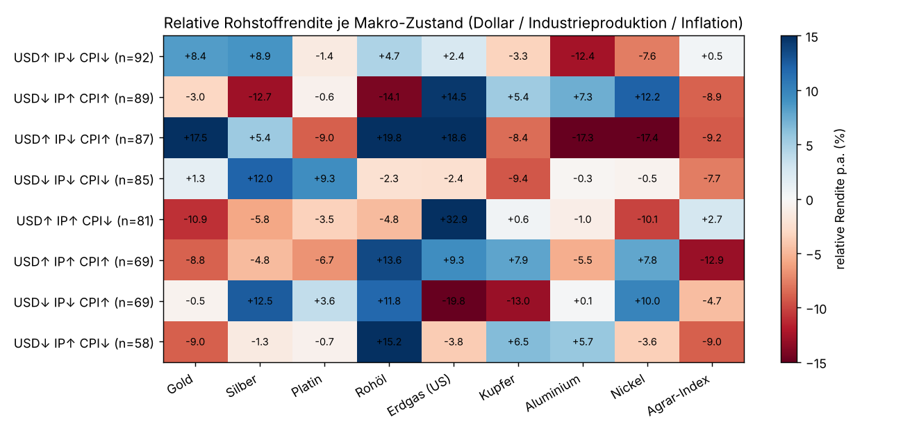
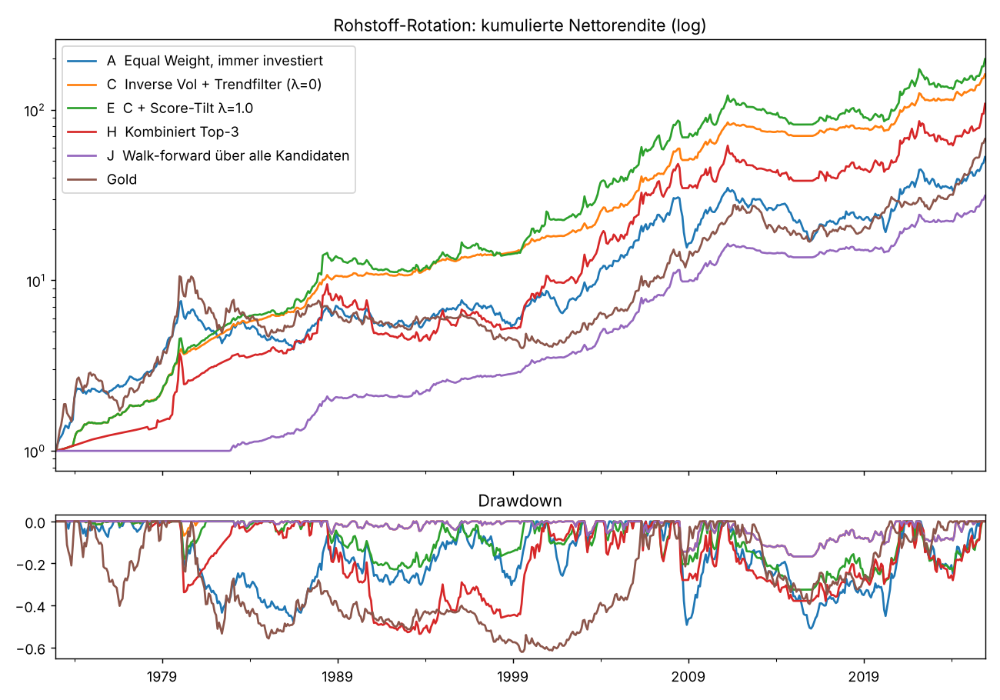
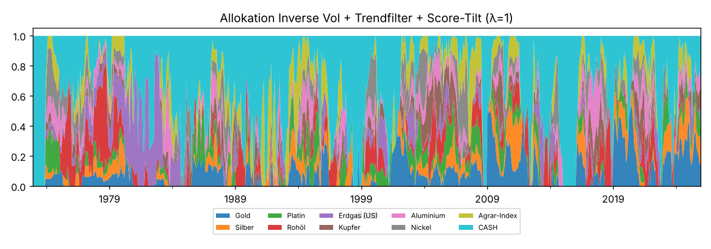
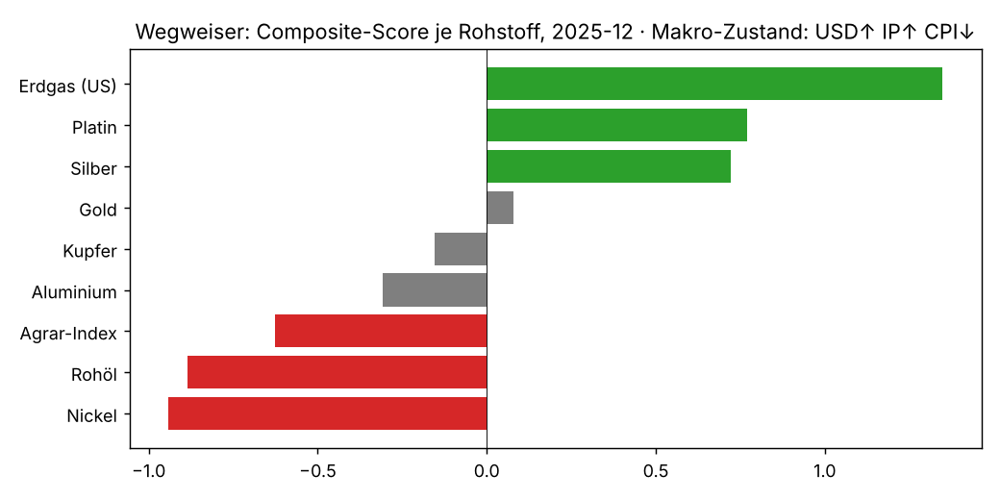

# Rohstoff-Rotation: Wegweiser-Modell
Universum: Gold, Silber, Platin, Rohöl, Erdgas (US), Kupfer, Aluminium, Nickel, Agrar-Index. Stichprobe 1972-12 bis 2025-12; Rohstoffe treten ein, sobald Daten vorliegen (Erdgas/Aluminium/Nickel ab 1982). Alle Preise sind World-Bank-Monatsdurchschnitte, damit der Querschnitt zeitlich konsistent ist (LBMA-Monatsendkurse für Gold/Silber nur als Robustheitscheck). Alle Renditen monatlich; 'relativ' = Überschussrendite minus Durchschnitt aller verfügbaren Rohstoffe im selben Monat. Die Frage ist also nie 'steigt Öl?', sondern 'schlägt Öl die anderen Rohstoffe?'.

## 1. Die Rohstoffe einzeln
|  | Start | Rendite p.a. | Vol p.a. | Sharpe ex Cash | Max DD |
|---|---|---|---|---|---|
| Gold | 1973-01 | 0.083 | 0.171 | 0.288 | -0.621 |
| Silber | 1973-01 | 0.067 | 0.285 | 0.207 | -0.906 |
| Platin | 1973-01 | 0.051 | 0.206 | 0.130 | -0.704 |
| Rohöl | 1973-01 | 0.068 | 0.425 | 0.203 | -0.842 |
| Erdgas (US) | 1973-01 | 0.060 | 0.447 | 0.247 | -0.889 |
| Kupfer | 1973-01 | 0.047 | 0.219 | 0.118 | -0.646 |
| Aluminium | 1973-01 | 0.032 | 0.181 | 0.021 | -0.709 |
| Nickel | 1973-01 | 0.030 | 0.279 | 0.078 | -0.841 |
| Agrar-Index | 1973-01 | 0.025 | 0.097 | -0.151 | -0.380 |

### Korrelation der Monatsrenditen
|  | Gold | Silber | Platin | Rohöl | Erdgas (US) | Kupfer | Aluminium | Nickel | Agrar-Index |
|---|---|---|---|---|---|---|---|---|---|
| Gold | 1.00 | 0.74 | 0.59 | 0.19 | 0.05 | 0.31 | 0.21 | 0.12 | 0.30 |
| Silber | 0.74 | 1.00 | 0.66 | 0.17 | 0.05 | 0.36 | 0.28 | 0.19 | 0.30 |
| Platin | 0.59 | 0.66 | 1.00 | 0.18 | 0.09 | 0.40 | 0.35 | 0.26 | 0.27 |
| Rohöl | 0.19 | 0.17 | 0.18 | 1.00 | 0.17 | 0.14 | 0.16 | 0.17 | 0.21 |
| Erdgas (US) | 0.05 | 0.05 | 0.09 | 0.17 | 1.00 | 0.02 | 0.06 | 0.03 | 0.06 |
| Kupfer | 0.31 | 0.36 | 0.40 | 0.14 | 0.02 | 1.00 | 0.50 | 0.37 | 0.34 |
| Aluminium | 0.21 | 0.28 | 0.35 | 0.16 | 0.06 | 0.50 | 1.00 | 0.45 | 0.26 |
| Nickel | 0.12 | 0.19 | 0.26 | 0.17 | 0.03 | 0.37 | 0.45 | 1.00 | 0.21 |
| Agrar-Index | 0.30 | 0.30 | 0.27 | 0.21 | 0.06 | 0.34 | 0.26 | 0.21 | 1.00 |

## 2. Welcher Rohstoff in welchem Makro-Zustand? (relative Rendite p.a., Vollstichprobe)
Zustand = Trendrichtung über 3 Monate von Dollar (USD), Industrieproduktion (IP) und Inflation (CPI), um einen Monat verzögert. Positive Zahl = Rohstoff schlug den Rohstoff-Durchschnitt in diesem Zustand. Das Modell selbst nutzt diese Tabelle nur expanding (jeweils aus der Vergangenheit geschätzt und geschrumpft), die Vollstichprobe hier dient der Anschauung.
| state | Gold | Silber | Platin | Rohöl | Erdgas (US) | Kupfer | Aluminium | Nickel | Agrar-Index | Monate |
|---|---|---|---|---|---|---|---|---|---|---|
| USD↑ IP↓ CPI↓ | 0.084 | 0.089 | -0.014 | 0.047 | 0.024 | -0.033 | -0.124 | -0.076 | 0.005 | 92.000 |
| USD↓ IP↑ CPI↑ | -0.030 | -0.127 | -0.006 | -0.141 | 0.145 | 0.054 | 0.073 | 0.122 | -0.089 | 89.000 |
| USD↑ IP↓ CPI↑ | 0.175 | 0.054 | -0.090 | 0.198 | 0.186 | -0.084 | -0.173 | -0.174 | -0.092 | 87.000 |
| USD↓ IP↓ CPI↓ | 0.013 | 0.120 | 0.093 | -0.023 | -0.024 | -0.094 | -0.003 | -0.005 | -0.077 | 85.000 |
| USD↑ IP↑ CPI↓ | -0.109 | -0.058 | -0.035 | -0.048 | 0.329 | 0.006 | -0.010 | -0.101 | 0.027 | 81.000 |
| USD↑ IP↑ CPI↑ | -0.088 | -0.048 | -0.067 | 0.136 | 0.093 | 0.079 | -0.055 | 0.078 | -0.129 | 69.000 |
| USD↓ IP↓ CPI↑ | -0.005 | 0.125 | 0.036 | 0.118 | -0.198 | -0.130 | 0.001 | 0.100 | -0.047 | 69.000 |
| USD↓ IP↑ CPI↓ | -0.090 | -0.013 | -0.007 | 0.152 | -0.038 | 0.065 | 0.057 | -0.036 | -0.090 | 58.000 |

## 3. Signalqualität
### 3a. Querschnitt: Rang-IC gegen relative Rendite im Folgemonat bzw. in den Folge-3-Monaten
Frage: Sagt das Signal voraus, *welcher* Rohstoff die anderen schlägt? Zum Vergleich: im Multi-Asset-Modell lag der 12M-Momentum-IC bei 0.07–0.10 (t ≈ 3.5).
|  | Monate | IC | t | IC>0 | IC 3M | t 3M |
|---|---|---|---|---|---|---|
| trend_10m | 627.000 | 0.078 | 4.466 | 0.533 | 0.010 | 0.608 |
| momentum_combo | 623.000 | 0.021 | 1.219 | 0.504 | -0.019 | -1.082 |
| mom_12m | 623.000 | 0.013 | 0.720 | 0.490 | -0.019 | -1.067 |
| regime | 533.000 | 0.004 | 0.248 | 0.493 | 0.023 | 1.309 |
| combined | 533.000 | 0.000 | 0.014 | 0.490 | -0.035 | -1.906 |
| mom_6m | 629.000 | -0.007 | -0.391 | 0.507 | -0.026 | -1.511 |
| mom_3m | 632.000 | -0.013 | -0.749 | 0.473 | -0.016 | -0.985 |
| lt_rev_36m | 600.000 | -0.067 | -3.811 | 0.425 | -0.092 | -5.085 |

### 3b. Zeitreihe: Lohnt es sich, einen Rohstoff überhaupt zu halten?
Frage: Ist der Rohstoff über seinem 10-Monats-Schnitt, verdient er im Folgemonat mehr als darunter? Das ist Time-Series-Momentum (Moskowitz, Ooi & Pedersen 2012) und bei Rohstoffen die robustere Signalart. Monatsdurchschnitte überzeichnen den Effekt leicht; die LBMA-Monatsendkurse unten zeigen, dass er für Gold und Silber auch ohne Durchschnittsbildung besteht.
|  | über Trend p.a. | unter Trend p.a. | Differenz p.a. | t | Monate über | Monate unter |
|---|---|---|---|---|---|---|
| Gold | 0.120 | -0.051 | 0.171 | 3.730 | 372.000 | 264.000 |
| Silber | 0.181 | -0.058 | 0.238 | 3.028 | 312.000 | 324.000 |
| Platin | 0.108 | -0.066 | 0.174 | 3.143 | 340.000 | 296.000 |
| Rohöl | 0.183 | -0.030 | 0.213 | 1.874 | 348.000 | 288.000 |
| Erdgas (US) | 0.111 | 0.110 | 0.002 | 0.013 | 343.000 | 293.000 |
| Kupfer | 0.111 | -0.065 | 0.176 | 2.935 | 328.000 | 308.000 |
| Aluminium | 0.106 | -0.106 | 0.212 | 4.335 | 330.000 | 306.000 |
| Nickel | 0.169 | -0.109 | 0.277 | 3.577 | 299.000 | 337.000 |
| Agrar-Index | 0.032 | -0.065 | 0.097 | 3.650 | 332.000 | 304.000 |
|  | über Trend p.a. | unter Trend p.a. | Differenz p.a. | t | Monate über | Monate unter |
|---|---|---|---|---|---|---|
| Gold (LBMA Monatsende) | 0.097 | -0.006 | 0.104 | 1.903 | 370.000 | 266.000 |
| Silber (LBMA Monatsende) | 0.143 | 0.014 | 0.129 | 1.411 | 312.000 | 324.000 |

### Top-3 minus Bottom-3 (gleichgewichtet, brutto)
|  | Long-Short p.a. | LS Sharpe | Long-Bein p.a. (ex Cash) | Short-Bein p.a. (ex Cash) | Monate |
|---|---|---|---|---|---|
| mom_12m | -0.011 | -0.046 | 0.021 | 0.032 | 623.000 |
| momentum_combo | 0.014 | 0.060 | 0.036 | 0.022 | 623.000 |
| regime | 0.010 | 0.046 | 0.029 | 0.019 | 533.000 |
| combined | -0.021 | -0.088 | 0.017 | 0.039 | 533.000 |

### Stabilität über Teilperioden
|  | IC | t | Monate |
|---|---|---|---|
| 1973–1989 · momentum_combo | 0.085 | 2.615 | 192.000 |
| 1973–1989 · regime | 0.029 | 0.780 | 102.000 |
| 1973–1989 · combined | 0.070 | 1.584 | 102.000 |
| 1990–2005 · momentum_combo | -0.029 | -0.916 | 192.000 |
| 1990–2005 · regime | 0.041 | 1.431 | 192.000 |
| 1990–2005 · combined | -0.020 | -0.652 | 192.000 |
| 2006–2025 · momentum_combo | 0.011 | 0.394 | 239.000 |
| 2006–2025 · regime | -0.036 | -1.395 | 239.000 |
| 2006–2025 · combined | -0.013 | -0.488 | 239.000 |

## 4. Backtest long-only (1972-12 – 2025-12, 20 bp Kosten, Trendfilter → T-Bills)
Die Zeilen bauen aufeinander auf: A→B isoliert den Trendfilter, B→C die Volatilitätsgewichtung, C→D/E den Mehrwert des relativen Scores (Momentum + Regime), F–I die harte Top-N-Auswahl. Sharpe auf Überschussrendite über T-Bills.
|  | Ann. Return | Ann. Vol | Sharpe (ex Cash) | Max Drawdown | Calmar | Hit Rate | Ann. Turnover |
|---|---|---|---|---|---|---|---|
| A  Equal Weight, immer investiert | 0.078 | 0.144 | 0.284 | -0.510 | 0.152 | 0.549 |  |
| B  Equal Weight + Trendfilter | 0.106 | 0.104 | 0.596 | -0.191 | 0.554 | 0.648 |  |
| C  Inverse Vol + Trendfilter (λ=0) | 0.101 | 0.074 | 0.741 | -0.167 | 0.601 | 0.680 |  |
| D  C + Score-Tilt λ=0.5 | 0.105 | 0.092 | 0.657 | -0.229 | 0.459 | 0.658 |  |
| E  C + Score-Tilt λ=1.0 | 0.105 | 0.127 | 0.502 | -0.325 | 0.322 | 0.641 | 2.327 |
| F  Momentum Top-3 | 0.114 | 0.185 | 0.437 | -0.561 | 0.204 | 0.617 |  |
| G  Regime Top-3 | 0.094 | 0.144 | 0.383 | -0.317 | 0.296 | 0.683 |  |
| H  Kombiniert Top-3 | 0.092 | 0.172 | 0.340 | -0.535 | 0.173 | 0.661 | 3.467 |
| I  Kombiniert Top-4 | 0.097 | 0.141 | 0.408 | -0.420 | 0.230 | 0.670 |  |
| J  Walk-forward über alle Kandidaten | 0.083 | 0.073 | 0.650 | -0.167 | 0.498 | 0.640 |  |
| Gold | 0.083 | 0.171 | 0.288 | -0.621 | 0.133 | 0.522 |  |
| Rohöl | 0.068 | 0.425 | 0.203 | -0.842 | 0.081 | 0.519 |  |

Walk-forward: gewählte Kandidaten
|  | Jahre gewählt |
|---|---|
| tilt λ=0.0 | 44 |

### Rendite p.a. je Jahrzehnt
|  | InvVol+Trend+Tilt | Kombiniert Top-3 | Equal Weight | Gold |
|---|---|---|---|---|
| 1970s | 0.202 | 0.145 | 0.296 | 0.324 |
| 1980s | 0.138 | 0.112 | 0.002 | -0.011 |
| 1990s | 0.030 | 0.002 | 0.013 | -0.036 |
| 2000s | 0.169 | 0.185 | 0.133 | 0.149 |
| 2010s | 0.005 | 0.012 | -0.004 | 0.027 |
| 2020s | 0.139 | 0.149 | 0.141 | 0.195 |

## 5. Wegweiser, Stand 2025-12 · Makro-Zustand: USD↑ IP↑ CPI↓
Zwei Ebenen. **Trend** (Zeitreihe): aufwärts = halten, abwärts = Cash; das ist die verlässliche Ebene. **Score** (Querschnitt) = 0.7 × Momentum-Composite (z) + 0.3 × Regime-Erwartung (z); er kippt die Gewichte innerhalb der Aufwärtstrend-Rohstoffe und ist die unsichere Ebene (siehe ICs). Regime-Erwartung = aus der Vergangenheit geschätzte relative Rendite p.a. im aktuellen Makro-Zustand. Modellgewicht = Variante C (inverse Volatilität, nur Aufwärtstrends, Rest T-Bills), weil der Score im Backtest keinen Mehrwert zeigt: die Rangfolge ist Information, keine Handlungsanweisung.
| Rang | Rohstoff | Trend | Momentum 12M | Momentum 6M | Abstand 10M-Schnitt | Regime-Erwartung p.a. | Score | Modellgewicht |
|---|---|---|---|---|---|---|---|---|
| 1 | Erdgas (US) | aufwärts | 0.801 | 0.217 | 0.251 | 0.226 | 1.348 | 0.031 |
| 2 | Platin | aufwärts | 0.621 | 0.598 | 0.412 | -0.038 | 0.769 | 0.044 |
| 3 | Silber | aufwärts | 0.622 | 0.539 | 0.502 | -0.057 | 0.720 | 0.057 |
| 4 | Gold | aufwärts | 0.542 | 0.235 | 0.207 | -0.074 | 0.080 | 0.120 |
| 5 | Kupfer | aufwärts | 0.191 | 0.134 | 0.166 | 0.003 | -0.154 | 0.110 |
| 6 | Aluminium | aufwärts | 0.092 | 0.151 | 0.091 | -0.001 | -0.308 | 0.107 |
| 7 | Agrar-Index | abwärts | -0.047 | -0.045 | -0.020 | 0.027 | -0.626 | 0.000 |
| 8 | Rohöl | abwärts | -0.138 | -0.007 | -0.074 | -0.023 | -0.886 | 0.000 |
| 9 | Nickel | abwärts | -0.067 | -0.044 | -0.016 | -0.064 | -0.943 | 0.000 |
Cash-Anteil (T-Bills) des Modells: 53%.

### Rangfolge der letzten 24 Monate (1 = attraktivster Rohstoff)
| date | Gold | Silber | Platin | Rohöl | Erdgas (US) | Kupfer | Aluminium | Nickel | Agrar-Index |
|---|---|---|---|---|---|---|---|---|---|
| 2024-01 | 2 | 6 | 8 | 5 | 1 | 4 | 7 | 9 | 3 |
| 2024-02 | 3 | 7 | 8 | 1 | 2 | 4 | 5 | 9 | 6 |
| 2024-03 | 3 | 5 | 7 | 1 | 9 | 2 | 4 | 8 | 6 |
| 2024-04 | 1 | 2 | 7 | 3 | 9 | 5 | 6 | 8 | 4 |
| 2024-05 | 1 | 2 | 7 | 3 | 9 | 4 | 5 | 8 | 6 |
| 2024-06 | 2 | 1 | 8 | 4 | 7 | 3 | 5 | 9 | 6 |
| 2024-07 | 3 | 1 | 8 | 6 | 4 | 2 | 5 | 9 | 7 |
| 2024-08 | 2 | 1 | 7 | 6 | 8 | 3 | 4 | 9 | 5 |
| 2024-09 | 1 | 2 | 7 | 8 | 3 | 5 | 4 | 9 | 6 |
| 2024-10 | 2 | 1 | 3 | 9 | 5 | 6 | 4 | 8 | 7 |
| 2024-11 | 2 | 1 | 3 | 9 | 5 | 6 | 4 | 8 | 7 |
| 2024-12 | 1 | 2 | 5 | 8 | 7 | 6 | 4 | 9 | 3 |
| 2025-01 | 2 | 3 | 8 | 6 | 1 | 7 | 5 | 9 | 4 |
| 2025-02 | 3 | 2 | 9 | 5 | 1 | 6 | 4 | 8 | 7 |
| 2025-03 | 5 | 3 | 8 | 4 | 1 | 2 | 6 | 7 | 9 |
| 2025-04 | 3 | 4 | 8 | 5 | 1 | 2 | 7 | 6 | 9 |
| 2025-05 | 2 | 4 | 7 | 6 | 1 | 3 | 5 | 9 | 8 |
| 2025-06 | 2 | 3 | 5 | 7 | 1 | 4 | 6 | 9 | 8 |
| 2025-07 | 2 | 3 | 1 | 8 | 4 | 6 | 5 | 7 | 9 |
| 2025-08 | 2 | 4 | 1 | 9 | 3 | 6 | 5 | 7 | 8 |
| 2025-09 | 2 | 3 | 1 | 9 | 4 | 6 | 5 | 7 | 8 |
| 2025-10 | 2 | 3 | 1 | 9 | 4 | 6 | 5 | 7 | 8 |
| 2025-11 | 3 | 2 | 1 | 7 | 6 | 4 | 5 | 8 | 9 |
| 2025-12 | 4 | 3 | 2 | 8 | 1 | 5 | 6 | 9 | 7 |

## 6. Fazit
1. **Wann halten** lässt sich beantworten: Jeder Rohstoff ausser US-Erdgas verdient über seinem 10-Monats-Schnitt 10–18 % p.a. mehr als darunter (t = 1.9–4.3). Ein Portfolio, das nur Rohstoffe im Aufwärtstrend hält und sie nach inverser Volatilität gewichtet, erreicht Sharpe 0.74 bei −17 % Max-Drawdown gegenüber 0.28 und −51 % für dauerhaft gleichgewichtete Rohstoffe.
2. **Welcher zuerst** lässt sich mit Spotpreisen und Makrotrends *nicht* verlässlich beantworten: Querschnitts-ICs von Momentum und Regime liegen bei 0.00–0.02, Long-Short-Portfolios bringen nichts, und jede Kippung der Gewichte nach Score senkt den Sharpe (0.74 → 0.50). Der Walk-forward wählt in allen 44 Jahren die ungekippte Variante.
3. Was in der Literatur die Rangfolge innerhalb von Rohstoffen erklärt, fehlt in diesen Daten: Terminkurve/Roll-Rendite (Backwardation = Knappheit; Gorton, Hayashi & Rouwenhorst 2013), Lagerbestände und Hedging-Positionierung (CFTC). Der nächste Ausbauschritt ist deshalb nicht ein besseres Makromodell, sondern Futures-Daten mit Terminkurve.
4. Für Gold und Silber konkret: Silber schlägt Gold nicht vorhersagbar; beide folgen demselben Trend- und Dollarregime, Silber mit doppelter Amplitude. Wer Silber übergewichtet, kauft Hebel auf Gold, keine eigenständige Prognose.
