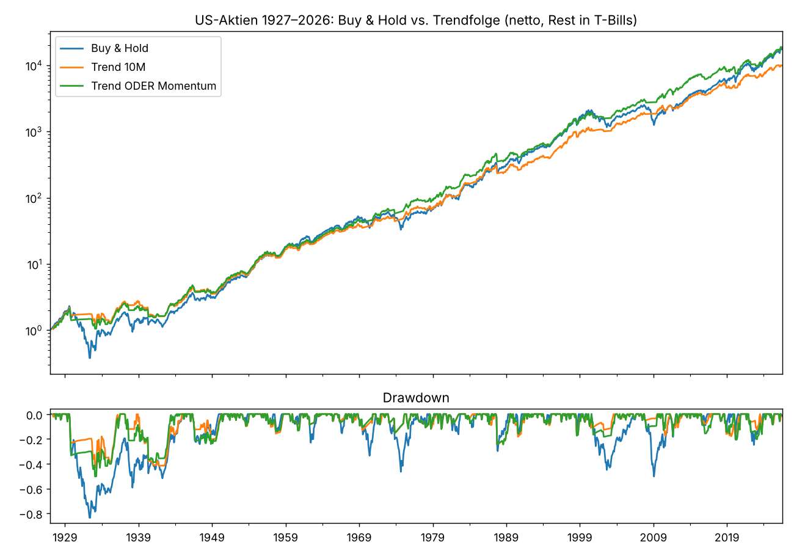
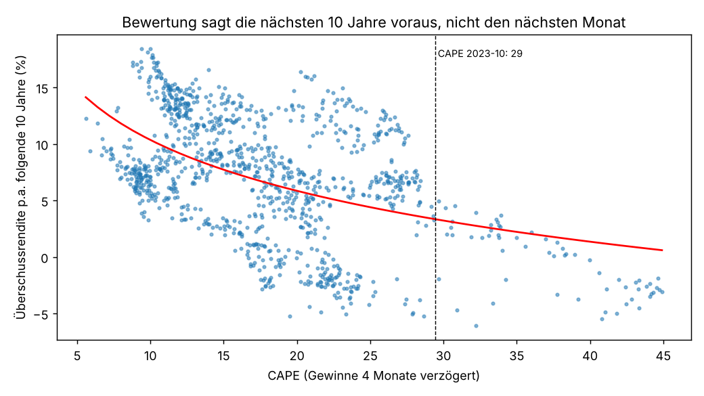
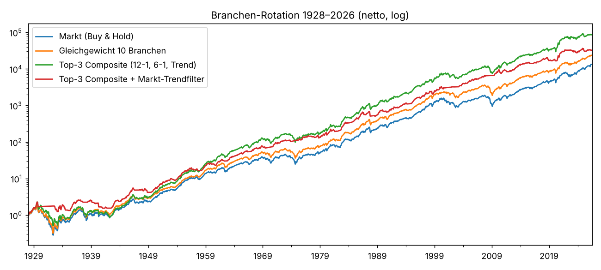

# US-Aktien: Wie viel halten, welche Branchen und Faktoren?
Markt = Kenneth-French-Gesamtmarkt (alle US-Aktien, value-weighted, inkl. Dividenden) 1926-07 bis 2026-07. Signal am Monatsende t, Rendite im Monat t+1; Cash = 1-Monats-T-Bill. Makrodaten und CPI 1 Monat, Shiller-Gewinne 6 Monate verzögert (quartalsweise Interpolation, siehe docs/AUDIT_equity_study.md).
## Teil A: Wie viel Aktien?

### A1. Was sagt die Aktien-Überschussrendite voraus? (t-Werte Newey-West, R²)
Positiver t-Wert = hohes Signal → höhere Folgerendite. Horizont 1 Monat = Timing, 60/120 Monate = Erwartung für die nächsten 5/10 Jahre.
| Signal → Überschussrendite | Start | 1M t | 1M R² | 12M t | 12M R² | 60M t | 60M R² | 120M t | 120M R² |
|---|---|---|---|---|---|---|---|---|---|
| Trend (Abstand 10M-Schnitt) | 1927 | 0.44 | 0.00 | -0.17 | 0.00 | -2.82 | 0.04 | -1.15 | 0.00 |
| Momentum 12M | 1927 | 0.93 | 0.00 | -0.69 | 0.00 | -2.39 | 0.04 | -0.29 | 0.00 |
| CAPE (hoch = teuer) | 1926 | -2.15 | 0.00 | -2.89 | 0.06 | -2.52 | 0.12 | -2.61 | 0.20 |
| Excess CAPE Yield | 1926 | 3.88 | 0.02 | 4.02 | 0.13 | 4.69 | 0.26 | 5.17 | 0.44 |
| Δ Kreditspread 6M | 1959 | 0.26 | 0.00 | 1.84 | 0.01 | 0.50 | 0.00 | 1.00 | 0.00 |
| Zinskurve 10y−3M | 1959 | 1.34 | 0.00 | 1.57 | 0.02 | 2.83 | 0.15 | 2.36 | 0.16 |
| Arbeitslosigkeit steigt (Sahm) | 1960 | 3.33 | 0.01 | 3.50 | 0.04 | 1.76 | 0.04 | 1.17 | 0.02 |
| VIX | 1990 | 0.83 | 0.00 | 1.47 | 0.03 | 0.16 | 0.00 | 0.83 | 0.03 |
Lesart: (1) Bewertung ist das einzige Signal mit echter Prognosekraft, und zwar umso mehr, je länger der Horizont: die Excess CAPE Yield erklärt 44 % der Varianz der 10-Jahres-Überschussrendite, aber nur 2 % des Folgemonats. (2) Trend und Momentum sagen die *durchschnittliche* Monatsrendite nicht voraus (t < 1); ihr Wert liegt im Vermeiden der grossen Verlustmonate (A5). (3) Steigende Arbeitslosigkeit ist ein *Kauf*-Signal (t = +3.3): wenn der Arbeitsmarkt kippt, ist der Kurs meist schon gefallen und die Folgerenditen sind hoch. Ein Makro-Risiko-Signal in diese Richtung einzubauen, wäre falsch. (4) Steigende Kreditspreads haben keine Prognosekraft für den Folgemonat.

### A2. Exposure-Strategien (Aktien oder T-Bills, monatlich, 5 bp je Wechsel)
Drei Stichproben: 1927–2026 nur mit Preissignalen; 1931–2023 mit Bewertung (ECY-Perzentil braucht 10 Jahre Vorlauf, Shiller-Gewinne enden 2023); 1962–2023 mit allen Signalen inkl. Makro.
| Strategie (1927–2026) | Rendite p.a. | Vol p.a. | Sharpe | Max DD | Calmar | Ø Aktienquote | Wechsel p.a. |
|---|---|---|---|---|---|---|---|
| Buy & Hold | 0.103 | 0.184 | 0.450 | -0.837 | 0.123 | 1.000 | 0.000 |
| Trend 10M | 0.097 | 0.125 | 0.546 | -0.430 | 0.226 | 0.730 | 1.471 |
| Momentum 12M | 0.099 | 0.126 | 0.556 | -0.444 | 0.223 | 0.706 | 0.868 |
| Trend ODER Momentum | 0.104 | 0.135 | 0.566 | -0.503 | 0.207 | 0.788 | 1.009 |
| Trend UND Momentum | 0.091 | 0.116 | 0.536 | -0.446 | 0.205 | 0.648 | 1.312 |
| Trend/Momentum-Mittel (0, ½, 1) | 0.099 | 0.121 | 0.573 | -0.411 | 0.240 | 0.718 | 2.039 |
| Strategie (1931–2023) | Rendite p.a. | Vol p.a. | Sharpe | Max DD | Calmar | Ø Aktienquote | Wechsel p.a. |
|---|---|---|---|---|---|---|---|
| Buy & Hold | 0.103 | 0.183 | 0.455 | -0.714 | 0.145 | 1.000 | 0.000 |
| Trend 10M | 0.094 | 0.123 | 0.536 | -0.416 | 0.226 | 0.728 | 1.503 |
| Trend/Momentum-Mittel (0, ½, 1) | 0.095 | 0.118 | 0.563 | -0.411 | 0.232 | 0.713 | 2.086 |
| Trend/Momentum-Mittel × ECY (0.75–1) | 0.090 | 0.098 | 0.587 | -0.355 | 0.253 | 0.625 | 2.828 |
| Bewertung (CAPE-Perzentil) | 0.090 | 0.115 | 0.512 | -0.385 | 0.233 | 0.686 | 4.575 |
| Trend × Bewertung | 0.080 | 0.083 | 0.568 | -0.320 | 0.250 | 0.495 | 4.195 |
| Strategie (1962–2023) | Rendite p.a. | Vol p.a. | Sharpe | Max DD | Calmar | Ø Aktienquote | Wechsel p.a. |
|---|---|---|---|---|---|---|---|
| Buy & Hold | 0.101 | 0.156 | 0.424 | -0.503 | 0.202 | 1.000 | 0.000 |
| Trend 10M | 0.099 | 0.114 | 0.510 | -0.244 | 0.406 | 0.741 | 1.431 |
| Momentum 12M | 0.093 | 0.115 | 0.457 | -0.242 | 0.383 | 0.707 | 0.829 |
| Trend ODER Momentum | 0.105 | 0.123 | 0.525 | -0.244 | 0.430 | 0.791 | 0.976 |
| Trend UND Momentum | 0.087 | 0.106 | 0.438 | -0.242 | 0.359 | 0.657 | 1.285 |
| Bewertung (CAPE-Perzentil) | 0.085 | 0.110 | 0.410 | -0.385 | 0.222 | 0.658 | 3.593 |
| Trend × Bewertung | 0.081 | 0.079 | 0.485 | -0.154 | 0.530 | 0.478 | 3.382 |
| Composite (Trend, Mom, Kredit, Arbeitsmarkt) | 0.087 | 0.112 | 0.415 | -0.269 | 0.322 | 0.775 | 2.894 |
| Trend + Kredit (Mittel) | 0.087 | 0.117 | 0.402 | -0.298 | 0.291 | 0.799 | 2.228 |
| Trend + Arbeitsmarkt (Mittel) | 0.089 | 0.111 | 0.438 | -0.269 | 0.331 | 0.768 | 1.642 |
| Trend/Momentum-Mittel (0, ½, 1) | 0.097 | 0.110 | 0.503 | -0.242 | 0.398 | 0.724 | 1.967 |
| Trend/Momentum-Mittel × ECY (0.75–1) | 0.091 | 0.093 | 0.517 | -0.200 | 0.454 | 0.610 | 2.846 |
Der Composite mit Kredit und Arbeitsmarkt ist schlechter als Trend allein (Sharpe 0.42 vs 0.51), und die Zerlegung zeigt: beide Makro-Bausteine schaden, Kredit (0.40) sogar stärker als Arbeitsmarkt (0.44). Der Grund ist mechanisch, nicht ökonomisch: Ein Baustein, der fast immer «investiert bleiben» sagt, verwässert den Trend-Ausstieg auf 50 % und liefert dafür keine eigene Information über den Folgemonat (A1). Bewertung allein senkt das Ergebnis (zu früh raus in langen Bullenmärkten, 3–4 Wechsel p.a.); als milde Skalierung (0.75–1) auf dem Trendsignal senkt sie Volatilität und Drawdown bei kleinem Renditeverzicht. **Modulkandidat:** Trend/Momentum-Mittel (Exposure 0, ½ oder 1), optional ECY-skaliert.

### A3. Robustheit: Trendfenster 6–18 Monate (1927–2026)
| Trendfenster | Sharpe | Max DD | Rendite p.a. |
|---|---|---|---|
| 6M | 0.509 | -0.462 | 0.093 |
| 8M | 0.498 | -0.539 | 0.090 |
| 10M | 0.546 | -0.430 | 0.097 |
| 12M | 0.556 | -0.455 | 0.099 |
| 15M | 0.559 | -0.474 | 0.101 |
| 18M | 0.558 | -0.491 | 0.101 |
Buy & Hold zum Vergleich: Sharpe 0.450, Max DD -0.837.

### A4. Grosse Crashes: Rendite vom Markthoch bis zum Tief
| Crash (Hoch → Tief) | Buy & Hold | Trend 10M | Trend ODER Momentum | Trend/Momentum-Mittel (0, ½, 1) |
|---|---|---|---|---|
| 1929-08 → 1932-06 | -84% | -20% | -30% | -25% |
| 1937-02 → 1938-03 | -49% | -12% | -21% | -16% |
| 1946-05 → 1949-06 | -17% | -20% | -22% | -20% |
| 1968-11 → 1970-06 | -34% | -7% | -4% | -6% |
| 1972-12 → 1974-09 | -47% | -10% | -10% | -3% |
| 1987-08 → 1987-11 | -30% | -24% | -24% | -24% |
| 2000-08 → 2002-09 | -45% | -8% | -18% | -10% |
| 2007-10 → 2009-02 | -50% | -4% | -10% | -7% |
| 2020-01 → 2020-03 | -20% | -8% | -20% | -14% |
| 2021-12 → 2022-09 | -25% | -6% | -14% | -10% |
Trendfolge spart in langen Baissen den Grossteil (1929–32: −20 % statt −84 %; 2007–09: −4 % statt −50 %). In schnellen Crashes hilft sie wenig, weil das Monatssignal erst nach dem Fall dreht (1987: −24 % statt −30 %), und in Seitwärtsphasen kostet sie (1946–49: schlechter als Buy & Hold). Für schnelle Crashes ist der Gold/Silber-Hedge die Ergänzung (8/8 positiv).

### A5. Was der Schutz kostet
| Strategie, 1962–2023 | Rendite in Monaten Markt > +3 % (Strategie − B&H) | Rendite in Monaten Markt < −5 % (Strategie − B&H) | Monate investiert |
|---|---|---|---|
| Trend 10M | -0.237 | 0.552 | 0.741 |
| Trend ODER Momentum | -0.186 | 0.463 | 0.791 |
| Trend/Momentum-Mittel (0, ½, 1) | -0.244 | 0.542 | 0.724 |

### A6. Midterm-Zyklus (Folge-12-Monate ab Ende Oktober, Überschussrendite)
| Start | n | Ø 12M Überschuss | Anteil > 0 | schlechtestes |
|---|---|---|---|---|
| Ende Okt. im Midterm-Jahr | 24.000 | 0.150 | 0.917 | -0.368 |
| Ende Okt. andere Jahre | 74.000 | 0.061 | 0.689 | -0.374 |
Bestätigt das Muster aus der Gold/Silber-Diskussion auf 100 Jahren. Wird nicht ins Modul eingebaut (25 Beobachtungen, Gefahr von Data Mining), aber im Report als Kontext ausgewiesen.

## Teil B: Welche Branchen und Faktoren?
10 Branchen-Portfolios von Kenneth French (value-weighted, SIC-Zuordnung, 1926–2026). Live-Abbildung über die Sektor-SPDRs (XLP, XLY, XLI, XLE, XLK, XLC, XLRE/XLY, XLV, XLU, XLF) ab 1998.

### B1. Die Branchen einzeln
| Branche (1926–2026) | Rendite p.a. | Vol p.a. | Sharpe | Max DD | Beta zum Markt |
|---|---|---|---|---|---|
| Basiskonsum | 0.11 | 0.16 | 0.51 | -0.67 | 0.74 |
| Langl. Konsum | 0.11 | 0.29 | 0.38 | -0.90 | 1.28 |
| Industrie | 0.11 | 0.22 | 0.42 | -0.89 | 1.12 |
| Energie | 0.11 | 0.22 | 0.42 | -0.77 | 0.89 |
| Technologie | 0.12 | 0.25 | 0.43 | -0.91 | 1.22 |
| Telekom | 0.09 | 0.16 | 0.40 | -0.72 | 0.67 |
| Handel | 0.11 | 0.20 | 0.46 | -0.84 | 0.97 |
| Gesundheit | 0.12 | 0.19 | 0.50 | -0.75 | 0.83 |
| Versorger | 0.09 | 0.19 | 0.39 | -0.85 | 0.76 |
| Übrige (Fin. u. a.) | 0.09 | 0.22 | 0.36 | -0.90 | 1.12 |

### B2. Welche Signale ordnen die Branchen? (Rang-IC gegen relative Folgemonatsrendite)
| Signal | Monate | Ø IC | Std IC | t | Anteil IC>0 |
|---|---|---|---|---|---|
| Momentum 12-1 | 1187.000 | 0.058 | 0.425 | 4.735 | 0.555 |
| Momentum 6-1 | 1193.000 | 0.040 | 0.421 | 3.265 | 0.545 |
| Momentum 3-1 | 1196.000 | 0.023 | 0.416 | 1.879 | 0.539 |
| Letzter Monat (Reversal) | 1200.000 | 0.070 | 0.413 | 5.850 | 0.561 |
| Trend 10M | 1191.000 | 0.065 | 0.418 | 5.397 | 0.577 |
| Niedrige Vol 36M | 1165.000 | 0.007 | 0.441 | 0.560 | 0.503 |
| Langfrist-Umkehr 60-12 | 1140.000 | 0.005 | 0.414 | 0.423 | 0.500 |
t-Werte je Teilperiode:
| Signal | 1927–1962 | 1963–1994 | 1995–2026 |
|---|---|---|---|
| Momentum 12-1 | 4.0 | 2.5 | 1.7 |
| Momentum 6-1 | 3.6 | 0.8 | 1.3 |
| Momentum 3-1 | 2.8 | 0.3 | 0.1 |
| Letzter Monat (Reversal) | 3.8 | 6.4 | 0.2 |
| Trend 10M | 4.6 | 3.7 | 1.0 |
| Niedrige Vol 36M | -0.1 | 1.2 | -0.1 |
| Langfrist-Umkehr 60-12 | 0.8 | 0.7 | -0.8 |
Branchen-Momentum (12-1) und Trend sind über 100 Jahre robust (t ≈ 5), aber deutlich schwächer geworden: seit 1995 t = 1.7 bzw. 1.0. Der 1-Monats-Effekt ist hier *Fortsetzung*, nicht Umkehr (positives IC, Moskowitz & Grinblatt 1999), und seit 1995 verschwunden.

### B3. Branchen-Rotation (monatlich, long-only)
| Strategie (1928–2026, 10 bp je Seite) | Rendite p.a. | Vol p.a. | Sharpe | Max DD | Calmar | Überrendite vs Markt p.a. | Tracking Error | Information Ratio |
|---|---|---|---|---|---|---|---|---|
| Markt (Buy & Hold) | 0.101 | 0.184 | 0.439 | -0.837 | 0.121 | 0.000 | 0.000 |  |
| Gleichgewicht 10 Branchen | 0.107 | 0.179 | 0.480 | -0.819 | 0.131 | 0.005 | 0.028 | 0.172 |
| Top-3 Momentum 12-1 | 0.126 | 0.183 | 0.566 | -0.752 | 0.168 | 0.023 | 0.076 | 0.301 |
| Top-3 Momentum 12-1, inverse Vol | 0.125 | 0.177 | 0.571 | -0.747 | 0.167 | 0.020 | 0.073 | 0.278 |
| Top-5 Momentum 12-1 | 0.121 | 0.176 | 0.557 | -0.745 | 0.163 | 0.017 | 0.053 | 0.322 |
| Top-3 Composite (12-1, 6-1, Trend) | 0.122 | 0.181 | 0.551 | -0.774 | 0.158 | 0.019 | 0.076 | 0.248 |
| Top-3 Composite + Markt-Trendfilter | 0.111 | 0.141 | 0.591 | -0.458 | 0.243 | 0.002 | 0.147 | 0.016 |

Long-Short Top-3 minus Bottom-3 nach Momentum 12-1: +4.0% p.a., Sharpe 0.29, positiv in 67% der Jahre.
### Rendite p.a. je Jahrzehnt
|  | Top-3 Composite (12-1, 6-1, Trend) | Top-3 Momentum 12-1 | Markt (Buy & Hold) | Composite − Markt |
|---|---|---|---|---|
| 1920er | +0.216 | +0.241 | +0.088 | +0.128 |
| 1930er | -0.010 | +0.020 | -0.003 | -0.007 |
| 1940er | +0.114 | +0.113 | +0.095 | +0.019 |
| 1950er | +0.225 | +0.215 | +0.183 | +0.041 |
| 1960er | +0.149 | +0.113 | +0.083 | +0.067 |
| 1970er | +0.059 | +0.069 | +0.061 | -0.001 |
| 1980er | +0.206 | +0.204 | +0.169 | +0.037 |
| 1990er | +0.179 | +0.193 | +0.180 | -0.001 |
| 2000er | +0.042 | +0.032 | -0.004 | +0.045 |
| 2010er | +0.134 | +0.138 | +0.136 | -0.002 |
| 2020er | +0.133 | +0.185 | +0.150 | -0.018 |

### B4. Relative Branchenrendite im Folgemonat je Makro-Regime (p.a., vs. Durchschnitt der 10 Branchen, 1960–2026)
Regime am Monatsende t aus den dann veröffentlichten Daten (Makro bis t−1), Rendite im Monat t+1. So ist die Tabelle das, was ein Investor hätte nutzen können.
**Wachstum × Inflation**
|  | Wachstum↑ Inflation↑ | Wachstum↑ Inflation↓ | Wachstum↓ Inflation↑ | Wachstum↓ Inflation↓ |
|---|---|---|---|---|
| Basiskonsum | -0.037 | +0.006 | +0.044 | -0.005 |
| Langl. Konsum | -0.021 | +0.013 | -0.074 | +0.106 |
| Industrie | -0.016 | +0.027 | -0.009 | -0.012 |
| Energie | +0.060 | -0.015 | +0.048 | -0.053 |
| Technologie | +0.063 | -0.011 | -0.031 | +0.011 |
| Telekom | -0.011 | -0.016 | -0.000 | -0.056 |
| Handel | -0.033 | +0.016 | +0.003 | +0.048 |
| Gesundheit | +0.024 | +0.002 | +0.015 | -0.019 |
| Versorger | -0.029 | -0.027 | +0.022 | -0.027 |
| Übrige (Fin. u. a.) | +0.000 | +0.005 | -0.019 | +0.006 |
| Monate | +196.000 | +183.000 | +207.000 | +204.000 |
**Konjunktur**
|  | IP-Rückgang (Rezession) | IP-Wachstum |
|---|---|---|
| Basiskonsum | +0.013 | -0.001 |
| Langl. Konsum | +0.130 | -0.035 |
| Industrie | -0.010 | -0.002 |
| Energie | -0.084 | +0.040 |
| Technologie | +0.026 | +0.007 |
| Telekom | -0.070 | -0.006 |
| Handel | +0.081 | -0.014 |
| Gesundheit | -0.021 | +0.014 |
| Versorger | -0.065 | +0.002 |
| Übrige (Fin. u. a.) | +0.000 | -0.004 |
| Monate | +196.000 | +602.000 |
**Zinskurve**
|  | Kurve invers | Kurve normal |
|---|---|---|
| Basiskonsum | -0.002 | +0.003 |
| Langl. Konsum | +0.008 | +0.004 |
| Industrie | -0.009 | -0.004 |
| Energie | -0.058 | +0.018 |
| Technologie | -0.031 | +0.019 |
| Telekom | +0.016 | -0.026 |
| Handel | +0.045 | +0.005 |
| Gesundheit | +0.006 | +0.005 |
| Versorger | -0.002 | -0.016 |
| Übrige (Fin. u. a.) | +0.027 | -0.007 |
| Monate | +97.000 | +702.000 |
Das Lehrbuch stimmt hier nur halb. Klar ist: Energie gewinnt im Folgemonat nach steigender Inflation (+6.0 % bzw. +4.8 % p.a. relativ) und verliert, solange die veröffentlichte Industrieproduktion fällt (−8.4 %). Nicht bestätigt: Defensive Sektoren (Basiskonsum, Gesundheit, Versorger) schlagen den Durchschnitt in diesen Monaten *nicht*; zyklische wie langlebiger Konsum (+13.0 %) und Handel (+8.1 %) tun es, weil der Markt die Erholung vorwegnimmt, während die Produktionsdaten noch fallen. Wer nach veröffentlichten Makrodaten in Defensive rotiert, kommt zu spät. Deshalb nutzt das Modul diese Tabelle nicht als Signal, sondern nur als Kontext und für die Szenario-Engine.

### B5. Faktoren: Prämien und Rotation
Long-short-Faktoren von Fama-French (nicht direkt investierbar; live über Faktor-ETFs wie VLUE, QUAL, MTUM, USMV, IJR, erst ab 2013 mit Historie).
| Faktor (long-short, 1963–2026) | Prämie p.a. | Vol p.a. | Sharpe | Max DD | Sharpe 1963–1989 | Sharpe 1990–2006 | Sharpe 2007–2026 |
|---|---|---|---|---|---|---|---|
| Markt | 0.07 | 0.15 | 0.47 | -0.56 | 0.30 | 0.52 | 0.65 |
| Size | 0.02 | 0.10 | 0.21 | -0.56 | 0.38 | 0.22 | -0.05 |
| Value | 0.04 | 0.10 | 0.34 | -0.58 | 0.65 | 0.53 | -0.11 |
| Quality | 0.03 | 0.08 | 0.38 | -0.42 | 0.36 | 0.42 | 0.40 |
| Investment | 0.03 | 0.07 | 0.41 | -0.28 | 0.64 | 0.52 | 0.01 |
| Momentum | 0.07 | 0.15 | 0.49 | -0.58 | 0.81 | 0.61 | 0.08 |
| Faktor-Rotation (1965–2026, brutto) | Prämie p.a. | Sharpe | Max DD |
|---|---|---|---|
| Alle 5 Faktoren gleichgewichtet | 0.038 | 0.820 | -0.154 |
| Faktor-Momentum (Zeitreihe) | 0.054 | 0.705 | -0.213 |
| Top-2 Faktoren nach 12M | 0.064 | 0.656 | -0.248 |
Value hat seit 2007 keine Prämie mehr geliefert, Quality und Momentum schon. Faktor-Momentum glättet das, ist aber ein Long-short-Konstrukt; für ein Long-only-System mit ETFs ist es Phase-2-Material mit kurzer Live-Historie.

### Aktueller Stand Branchen (2026-07)
| Branche, Stand 2026-07 | Momentum 12-1 | Momentum 6-1 | Trend 10M | Composite-Rang |
|---|---|---|---|---|
| Industrie | 0.488 | 0.346 | 0.069 | 1.000 |
| Technologie | 0.315 | 0.126 | 0.076 | 2.000 |
| Energie | 0.281 | 0.185 | 0.141 | 3.000 |
| Gesundheit | 0.270 | 0.058 | 0.063 | 4.000 |
| Basiskonsum | 0.084 | 0.096 | 0.071 | 5.000 |
| Langl. Konsum | 0.325 | -0.038 | -0.179 | 6.000 |
| Versorger | 0.155 | 0.104 | 0.012 | 7.000 |
| Übrige (Fin. u. a.) | 0.073 | 0.030 | 0.070 | 8.000 |
| Handel | 0.057 | 0.031 | 0.051 | 9.000 |
| Telekom | -0.123 | -0.082 | -0.052 | 10.000 |

## Stand Aktien-Exposure (2026-07)
Trend: über 10M-Schnitt (+6.2%) · Momentum 12M: +14.7% · Δ Kreditspread 6M: -0.11 · Sahm-Indikator: 0.23 · letzter CAPE (2023-10): 29.4 (Perzentil seit 1881: 89%).
Hinweis: CAPE endet mit den Shiller-Gewinnen 2023-06 im Repo; live kommt er in Phase 1 aus einer aktuellen Quelle.
