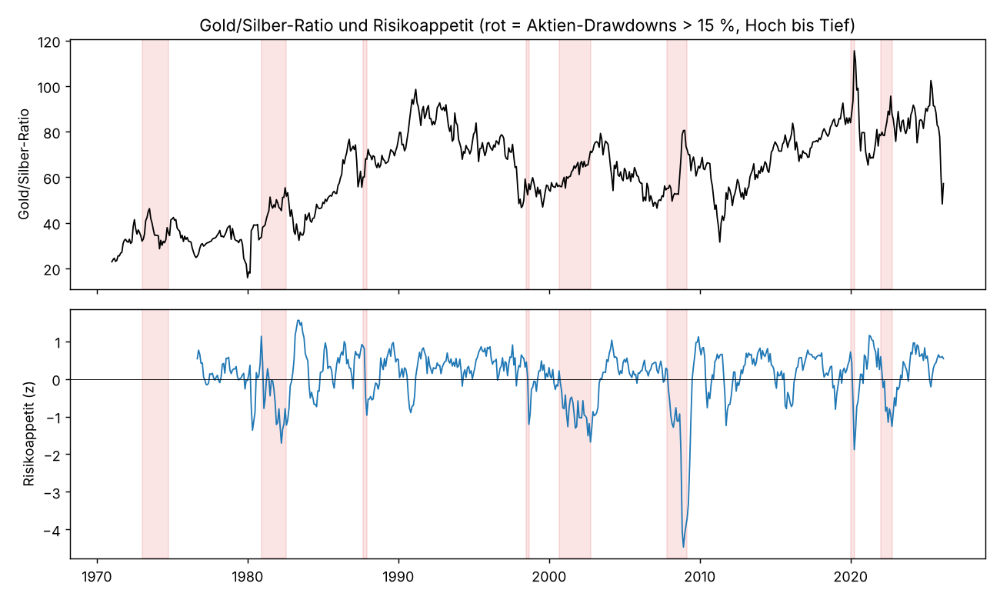

# Gold/Silber als De-Risk-Indikator
Monatsdaten 1971-01 bis 2026-02. Spread = log-Änderung der Gold/Silber-Ratio = Gold minus Silber (dollar-neutral). Risikoappetit = Durchschnitt expandierender z-Scores aus Aktien-Momentum, Aktientrend, Kreditspread (Niveau und 6M-Änderung, invertiert) und VIX (invertiert, ab 1990). Hoch = Risk-on/Sorglosigkeit, tief = Angst. Alles ohne Look-ahead.

## 1. Hedge: Was macht der Spread, wenn Aktien fallen? (gleicher Monat)
Durchschnittliche Monatsrendite je Aktienmonat-Klasse.
| Aktienmonat | Monate | Aktien | Gold | Silber | Spread | Gold_schlägt_Silber |
|---|---|---|---|---|---|---|
| < −10 % | 8.000 | -0.136 | -0.017 | -0.074 | 0.066 | 0.625 |
| −10…−5 % | 47.000 | -0.070 | 0.021 | -0.002 | 0.032 | 0.681 |
| −5…−2 % | 82.000 | -0.032 | 0.009 | 0.002 | 0.008 | 0.549 |
| −2…+2 % | 252.000 | 0.001 | 0.009 | 0.004 | 0.007 | 0.575 |
| +2…+5 % | 172.000 | 0.034 | 0.005 | 0.020 | -0.012 | 0.430 |
| > +5 % | 99.000 | 0.074 | 0.011 | 0.028 | -0.015 | 0.404 |

Beta des Spreads auf Aktien: gesamt -0.35, in Monaten mit Aktien < −5 %: -1.10 (negativ = Spread steigt, wenn Aktien fallen = Hedge).

### Grosse Aktien-Drawdowns: Gold vs. Silber vom Aktien-Hoch bis zum Aktien-Tief
| Aktien-Drawdown > 15 % (Hoch → Tief) | Aktien | Gold | Silber | Spread (log) | Ratio Start | Ratio Tief Aktien |
|---|---|---|---|---|---|---|
| 1972-12 → 1974-09 | -0.43 | 1.33 | 1.09 | 0.11 | 31.95 | 35.63 |
| 1980-11 → 1982-07 | -0.16 | -0.45 | -0.64 | 0.43 | 33.64 | 51.68 |
| 1987-08 → 1987-11 | -0.30 | 0.09 | -0.04 | 0.12 | 60.08 | 67.89 |
| 1998-06 → 1998-08 | -0.15 | -0.08 | -0.11 | 0.03 | 55.30 | 57.14 |
| 2000-08 → 2002-09 | -0.45 | 0.17 | -0.08 | 0.24 | 56.42 | 71.41 |
| 2007-10 → 2009-02 | -0.51 | 0.21 | -0.08 | 0.27 | 55.13 | 72.07 |
| 2019-12 → 2020-03 | -0.19 | 0.06 | -0.23 | 0.32 | 83.94 | 115.50 |
| 2021-12 → 2022-09 | -0.24 | -0.07 | -0.18 | 0.12 | 78.23 | 87.89 |
Spread positiv in 8 von 8 Episoden, Median +18%.

## 2. Kündigt hoher Risikoappetit einen Gold-Vorsprung an?
Quintile des Risikoappetit-Index über die ganze Stichprobe (zur Einteilung; der Index selbst ist ohne Look-ahead).
| Risikoappetit-Quintil | Monate | Spread 3M | Spread 12M | Gold gewinnt 12M | Aktien 12M | P(Aktien-DD > 10 % in 12M) |
|---|---|---|---|---|---|---|
| Q1 Angst | 119.00 | 0.01 | -0.02 | 0.51 | 0.14 | 0.34 |
| Q2 | 119.00 | -0.02 | 0.06 | 0.66 | 0.13 | 0.13 |
| Q3 | 119.00 | -0.00 | 0.01 | 0.61 | 0.13 | 0.18 |
| Q4 | 119.00 | 0.00 | -0.01 | 0.49 | 0.14 | 0.13 |
| Q5 Sorglos | 119.00 | 0.03 | 0.06 | 0.75 | 0.11 | 0.16 |

Regression Spread(t→t+H) auf Risikoappetit(t):
| Horizont | %-Pkt je SD Risikoappetit | t (NW) | R² |
|---|---|---|---|
| 3M | 0.96 | 1.75 | 0.01 |
| 6M | 2.32 | 2.42 | 0.02 |
| 12M | 2.64 | 1.78 | 0.02 |
| 24M | 5.00 | 2.51 | 0.04 |

## 3. Kombination: Ratio-Bewertung × Risikoappetit
Folgende 12-Monats-Spread-Rendite (positiv = Gold schlägt Silber):
| 12M Gold vs Silber (log) | Angst | neutral | Risk-on |
|---|---|---|---|
| Ratio tief (z<−1) | +0.14 | +0.04 | +0.12 |
| Ratio normal | +0.06 | +0.00 | +0.03 |
| Ratio hoch (z>1) | -0.07 | +0.02 | -0.03 |
Anteil Gold gewinnt:
| 12M Gold vs Silber (log) | Angst | neutral | Risk-on |
|---|---|---|---|
| Ratio tief (z<−1) | 62% | 60% | 79% |
| Ratio normal | 76% | 62% | 63% |
| Ratio hoch (z>1) | 38% | 56% | 51% |
Anzahl Monate:
| 12M Gold vs Silber (log) | Angst | neutral | Risk-on |
|---|---|---|---|
| Ratio tief (z<−1) | 16 | 43 | 35 |
| Ratio normal | 93 | 92 | 119 |
| Ratio hoch (z>1) | 88 | 60 | 37 |

Regression 12M-Spread auf Ratio-z, Risikoappetit und Interaktion (Newey-West 18 Lags):
| Faktor | %-Pkt je SD | t |
|---|---|---|
| const | 2.53 | 1.15 |
| Ratio-z | -5.47 | -2.50 |
| Risikoappetit | -0.26 | -0.12 |
| Interaktion | 1.83 | 1.72 |
R² = 0.10, n = 583.

### Strategien
| Strategie (dollar-neutral, 12M-Tranchen, netto) | Rendite p.a. | Vol p.a. | Sharpe | Max DD | Korr. zu Aktien | Rendite in Aktien-Monaten < −5 % | Ø |Position| |
|---|---|---|---|---|---|---|---|
| Nur Ratio-Bewertung | 0.027 | 0.125 | 0.217 | -0.395 | -0.001 | 0.006 | 0.457 |
| Nur Risikoappetit | 0.009 | 0.069 | 0.125 | -0.459 | 0.031 | -0.000 | 0.257 |
| Ratio + Risikoappetit | 0.018 | 0.075 | 0.240 | -0.282 | 0.013 | 0.003 | 0.271 |
| Bedingt: Ratio tief & Risk-on (bzw. Spiegelbild) | 0.019 | 0.080 | 0.243 | -0.232 | 0.005 | 0.002 | 0.255 |

## 4. Umgekehrt: Warnt ein steigender Gold/Silber-Spread vor Aktienschwäche?
| Signal | Aktien 12M wenn ja | Aktien 12M wenn nein | P(DD>10 %) wenn ja | P(DD>10 %) wenn nein |
|---|---|---|---|---|
| Spread 3M gestiegen (Gold schlägt Silber) | 0.13 | 0.12 | 0.23 | 0.17 |
| Spread 6M gestiegen | 0.13 | 0.11 | 0.21 | 0.20 |
Regression Aktienrendite 12M auf 6M-Spread-Änderung: +1.1 %-Pkt je SD, t = 1.0.

## Stand (letzte Daten: Ratio 2026-02, Risikoappetit 2026-02)
Ratio-z 60M: -2.8 · Risikoappetit-Index: +0.54 (Perzentil seit 1971: 75%). Komponenten: Aktien-Mom 12M +0.3, Aktien vs 10M +0.6, −Kreditspread +1.3, −ΔKreditspread 6M +0.4, −VIX -0.0

