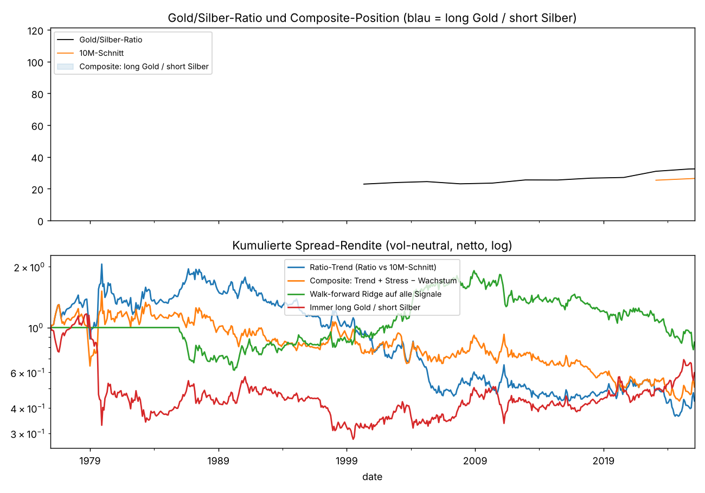
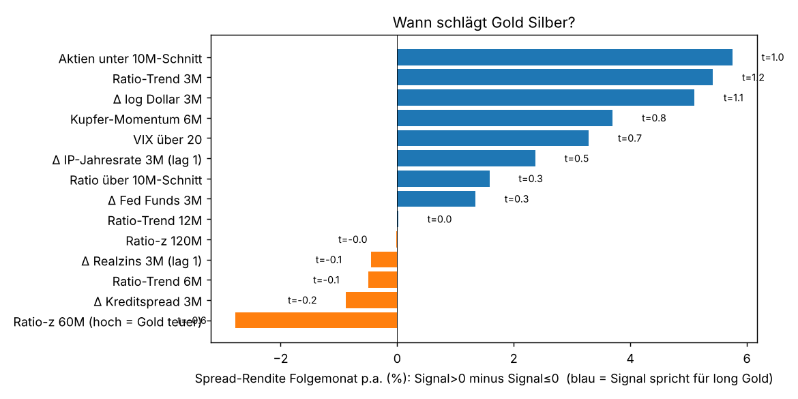
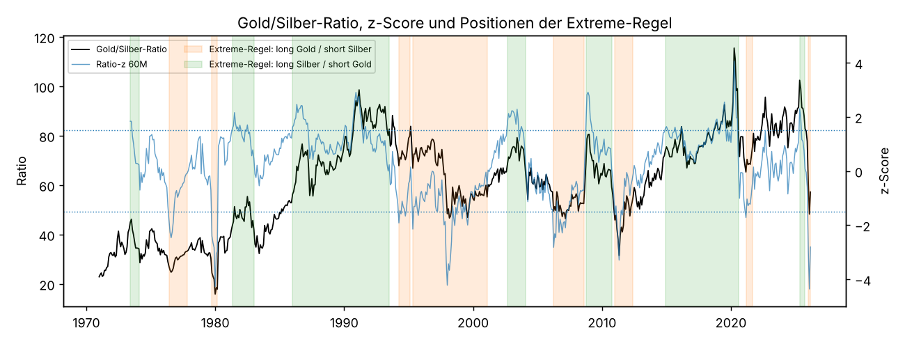
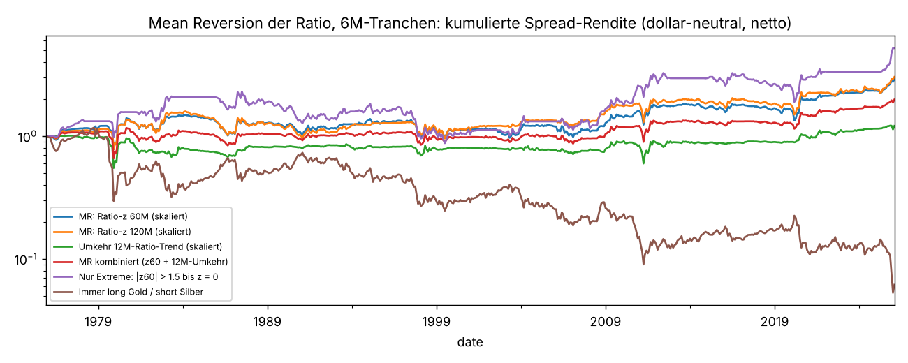

# Gold vs. Silber: Wann lohnt sich long Gold / short Silber?
Daten: LBMA-Fixings (echte Monatsendkurse) 1971-01 bis 2026-02 (letzter Monat: Fix vom 25.02.2026, Monat unvollständig). Spread = Rendite Gold minus Rendite Silber. Hauptvariante **vol-neutral**: Silber wird mit h = σ_Gold/σ_Silber (36M, ex ante, typisch 0.55–0.65) gehebelt, sonst ist 'long Gold / short Silber' vor allem eine Wette gegen das Edelmetall-Beta. Positive Spread-Rendite = Gold schlägt Silber. Der Spread ist selbstfinanzierend; Sharpe daher ohne Cash-Abzug. Nicht modelliert: Leihgebühr für Silber-Short, Margin.

## 1. Der Spread an sich (immer long Gold / short Silber)
|  | Rendite p.a. | Vol p.a. | Sharpe | Max DD | Trefferquote | Monate |
|---|---|---|---|---|---|---|
| dollar-neutral | -0.019 | 0.236 | -0.080 | -0.969 | 0.517 | 662.000 |
| vol-neutral | -0.000 | 0.164 | -0.000 | -0.854 | 0.517 | 638.000 |
Aktuelle Ratio: 57.2 (Median seit 1971: 63.0, 10-Jahres-Mittel: 81.1). Hedge-Ratio h aktuell: 0.37.

## 2. Welche Signale sagen den Spread im Folgemonat voraus? (1971–2025)
Vol-neutraler Spread. 'Signal>0' = durchschnittliche annualisierte Spread-Rendite im Folgemonat, wenn das Signal positiv ist. Positive Differenz = bei positivem Signal lohnt sich long Gold / short Silber. Steigung = Regression des Spreads (%/Monat) auf das standardisierte Signal.
| Signal | Signal>0 p.a. | Signal≤0 p.a. | Differenz p.a. | t (Differenz) | Steigung %/Mon je SD | t (NW) | Monate >0 | Monate ≤0 |
|---|---|---|---|---|---|---|---|---|
| Ratio-Trend 3M | 0.03 | -0.03 | 0.05 | 1.18 | 0.26 | 1.51 | 341.00 | 297.00 |
| Ratio-Trend 6M | -0.00 | 0.00 | -0.00 | -0.10 | -0.13 | -0.71 | 360.00 | 278.00 |
| Ratio-Trend 12M | -0.00 | -0.00 | 0.00 | 0.00 | -0.29 | -1.35 | 385.00 | 253.00 |
| Ratio über 10M-Schnitt | 0.01 | -0.01 | 0.02 | 0.32 | -0.05 | -0.26 | 373.00 | 265.00 |
| Ratio-z 60M (hoch = Gold teuer) | -0.02 | 0.01 | -0.03 | -0.59 | -0.23 | -1.17 | 380.00 | 253.00 |
| Ratio-z 120M | 0.00 | 0.00 | -0.00 | -0.00 | -0.22 | -1.09 | 387.00 | 216.00 |
| Δ Kreditspread 3M | -0.00 | 0.00 | -0.01 | -0.19 | 0.22 | 1.30 | 280.00 | 358.00 |
| VIX über 20 | 0.03 | 0.00 | 0.03 | 0.73 | 0.07 | 0.46 | 162.00 | 271.00 |
| Aktien unter 10M-Schnitt | 0.04 | -0.02 | 0.06 | 1.03 | 0.43 | 2.26 | 153.00 | 484.00 |
| Δ IP-Jahresrate 3M (lag 1) | 0.01 | -0.01 | 0.02 | 0.53 | 0.16 | 0.93 | 299.00 | 339.00 |
| Kupfer-Momentum 6M | 0.02 | -0.02 | 0.04 | 0.83 | -0.07 | -0.33 | 327.00 | 311.00 |
| Δ log Dollar 3M | 0.02 | -0.03 | 0.05 | 1.15 | 0.05 | 0.27 | 320.00 | 313.00 |
| Δ Realzins 3M (lag 1) | 0.00 | 0.00 | -0.00 | -0.10 | 0.06 | 0.31 | 313.00 | 324.00 |
| Δ Fed Funds 3M | 0.01 | -0.01 | 0.01 | 0.30 | 0.01 | 0.07 | 313.00 | 325.00 |

### Stabilität: t-Werte je Teilperiode
| Signal (t-Wert der Steigung) | 1971–1989 | 1990–2007 | 2008–2026 |
|---|---|---|---|
| Ratio-Trend 6M | -0.4 | -0.9 | -0.2 |
| Ratio über 10M-Schnitt | 0.2 | -1.2 | 0.0 |
| Ratio-z 60M (hoch = Gold teuer) | -0.5 | -0.7 | -0.7 |
| Δ Kreditspread 3M | 0.6 | 2.3 | 0.7 |
| Aktien unter 10M-Schnitt | 1.2 | 3.9 | 0.1 |
| Kupfer-Momentum 6M | -1.5 | 1.1 | 1.1 |
| Δ log Dollar 3M | 0.1 | -0.6 | 1.0 |

### Stressphasen
Gold ist der Krisen-, Silber der Konjunktur-Edelmetall: in Stress-Monaten verliert Silber typischerweise mehr.
| Zustand | Monate | Spread gleicher Monat p.a. | Spread Folgemonat p.a. | t Folgemonat | Gold schlägt Silber (Folgemonat) |
|---|---|---|---|---|---|
| Aktien-Drawdown > 15 % | 123.00 | 0.02 | -0.00 | -0.02 | 0.52 |
| Kreditspread 3M +0.3 Pkt | 44.00 | 0.08 | 0.08 | 0.96 | 0.55 |
| IP-Jahresrate < 0 (Rezession) | 176.00 | 0.02 | 0.01 | 0.14 | 0.49 |
| VIX > 30 | 33.00 | 0.21 | 0.03 | 0.29 | 0.55 |

## 3. Strategien (1975-12 – 2026-02, 10 bp je Bein und Wechsel)
Position +1 = long Gold / short Silber, −1 = long Silber / short Gold. Composite = Trend der Ratio + Stress − Wachstum, gleichgewichtet und a priori festgelegt (nicht gefittet). Walk-forward Ridge = jedes Jahr neu geschätzte Regression auf alle Signale, nur Vergangenheit.
| Strategie (netto, vol-neutral) | Rendite p.a. | Vol p.a. | Sharpe | Max DD | Trefferquote | Monate | Anteil long Gold |
|---|---|---|---|---|---|---|---|
| Immer long Gold / short Silber | 0.00 | 0.15 | 0.01 | -0.76 | 0.52 | 603.00 | 1.00 |
| Ratio-Trend (Ratio vs 10M-Schnitt) | -0.01 | 0.15 | -0.03 | -0.82 | 0.49 | 603.00 | 0.59 |
| Ratio-Momentum 6M | -0.01 | 0.15 | -0.07 | -0.87 | 0.49 | 603.00 | 0.57 |
| Stress (Kreditspread + Aktientrend) | 0.03 | 0.15 | 0.17 | -0.62 | 0.51 | 603.00 | 0.43 |
| Wachstum invers (Kupfer + IP) | -0.02 | 0.15 | -0.15 | -0.90 | 0.49 | 603.00 | 0.58 |
| Mean Reversion (Ratio-z 60M) | -0.01 | 0.15 | -0.04 | -0.79 | 0.50 | 603.00 | 0.41 |
| Composite: Trend + Stress − Wachstum | -0.00 | 0.15 | -0.01 | -0.71 | 0.49 | 603.00 | 0.49 |
| Composite skaliert (Position −1…+1) | 0.01 | 0.12 | 0.05 | -0.48 | 0.46 | 603.00 | 0.49 |
| Walk-forward Ridge auf alle Signale | 0.00 | 0.11 | 0.03 | -0.59 | 0.51 | 603.00 | 0.36 |

### Spread-Rendite p.a. je Jahrzehnt
|  | Ratio-Trend (Ratio vs 10M-Schnitt) | Composite: Trend + Stress − Wachstum | Walk-forward Ridge auf alle Signale | Immer long Gold / short Silber |
|---|---|---|---|---|
| 1970s | 0.216 | 0.141 | 0.000 | -0.221 |
| 1980s | -0.010 | -0.029 | -0.039 | 0.047 |
| 1990s | -0.048 | -0.011 | 0.047 | -0.028 |
| 2000s | -0.048 | 0.002 | 0.057 | 0.047 |
| 2010s | -0.007 | -0.030 | -0.026 | 0.003 |
| 2020s | -0.003 | 0.002 | -0.041 | 0.052 |

### Robustheit: dieselben Signale, dollar-neutraler Spread
|  | Rendite p.a. | Vol p.a. | Sharpe | Max DD | Trefferquote | Monate |
|---|---|---|---|---|---|---|
| Ratio-Trend (Ratio vs 10M-Schnitt) | -0.02 | 0.23 | -0.09 | -0.98 | 0.50 | 603.00 |
| Composite: Trend + Stress − Wachstum | -0.01 | 0.23 | -0.03 | -0.93 | 0.48 | 603.00 |

## 4. Der eigentliche Effekt: Mean Reversion über 1–3 Jahre
Auf Monatssicht ist der Spread Rauschen. Über 6–36 Monate kehrt die Ratio aber zurück: ist Gold relativ zu Silber teuer (Ratio hoch, z > 0) oder ist die Ratio im letzten Jahr stark gestiegen, holt Silber in den folgenden 1–3 Jahren auf, und umgekehrt. Abhängige Variable: log-Änderung der Ratio über H Monate (= Gold minus Silber, dollar-neutral). Newey-West mit H+6 Lags wegen überlappender Fenster.
| Horizont | Ratio-Niveau: %-Pkt je SD | Ratio-Niveau: t | Ratio-Niveau: R² | Ratio-z 60M: %-Pkt je SD | Ratio-z 60M: t | Ratio-z 60M: R² | Ratio-Trend 12M: %-Pkt je SD | Ratio-Trend 12M: t | Ratio-Trend 12M: R² | unabh. Fenster ≈ |
|---|---|---|---|---|---|---|---|---|---|---|
| 1M | -0.79 | -2.51 | 0.01 | -0.66 | -1.87 | 0.01 | -0.64 | -1.54 | 0.01 | 650.00 |
| 3M | -2.32 | -2.84 | 0.04 | -2.18 | -2.26 | 0.03 | -1.92 | -1.68 | 0.03 | 216.00 |
| 6M | -4.31 | -3.19 | 0.07 | -4.56 | -2.81 | 0.08 | -3.81 | -2.17 | 0.06 | 107.00 |
| 12M | -6.34 | -3.16 | 0.11 | -6.04 | -2.93 | 0.10 | -3.91 | -2.27 | 0.04 | 53.00 |
| 24M | -9.74 | -3.29 | 0.16 | -9.13 | -2.83 | 0.15 | -7.93 | -3.57 | 0.11 | 26.00 |
| 36M | -11.23 | -3.09 | 0.20 | -8.20 | -2.42 | 0.11 | -7.74 | -4.55 | 0.09 | 17.00 |
Bei 24 Monaten gibt es seit 1971 nur rund 26 unabhängige Fenster. Die t-Werte sind um die Überlappung bereinigt, aber die Evidenz ruht auf wenigen grossen Zyklen (1980, 1990–93, 2008, 2011, 2020, 2025). Die Spalte Ratio-Niveau nutzt den Mittelwert der ganzen Stichprobe (leichter Look-ahead); Ratio-z 60M nutzt nur die letzten 5 Jahre und ist die saubere Variante.
### Folgerenditen nach Ratio-z (60M), ohne fest gewählte Schwellen wie 'Ratio > 80'
| Ratio-z 60M | Monate | Gold vs Silber 12M | Gold gewinnt 12M | Gold vs Silber 24M | Gold gewinnt 24M |
|---|---|---|---|---|---|
| z < −2 (Ratio extrem tief) | 29.00 | 0.23 | 0.83 | 0.37 | 0.90 |
| −2 ≤ z < −1 | 72.00 | 0.04 | 0.64 | 0.09 | 0.67 |
| −1 ≤ z ≤ 1 | 334.00 | 0.03 | 0.64 | 0.05 | 0.61 |
| 1 < z ≤ 2 | 169.00 | -0.02 | 0.49 | -0.05 | 0.36 |
| z > 2 (Ratio extrem hoch) | 30.00 | -0.15 | 0.20 | -0.18 | 0.13 |
### Langsame Strategien: Sharpe je Spread-Definition und Haltedauer
Position −1…+1, monatlich neu entschieden, als überlappende Tranchen H Monate gehalten. Der Effekt lebt in der **dollar-neutralen** Ratio (1 CHF Gold long, 1 CHF Silber short); die vol-neutrale Variante hält netto Silber-Exposure, deren Rauschen das Signal überdeckt. Mit monatlicher Haltedauer frisst das Rauschen den Effekt.
| Sharpe (netto) | dollar-neutral, Haltedauer 1M | dollar-neutral, Haltedauer 6M | dollar-neutral, Haltedauer 12M | vol-neutral, Haltedauer 1M | vol-neutral, Haltedauer 6M | vol-neutral, Haltedauer 12M |
|---|---|---|---|---|---|---|
| MR kombiniert (z60 + 12M-Umkehr) | 0.07 | 0.17 | 0.17 | 0.02 | 0.17 | 0.17 |
| MR: Ratio-z 120M (skaliert) | 0.12 | 0.22 | 0.23 | 0.04 | 0.17 | 0.16 |
| MR: Ratio-z 60M (skaliert) | 0.10 | 0.22 | 0.23 | 0.01 | 0.17 | 0.19 |
| Nur Extreme: |z60| > 1.5 bis z = 0 | 0.14 | 0.28 | 0.27 | 0.07 | 0.20 | 0.17 |
| Umkehr 12M-Ratio-Trend (skaliert) | 0.03 | 0.09 | 0.05 | 0.01 | 0.12 | 0.10 |
### Details dollar-neutral
| Strategie (dollar-neutral, netto) | Rendite p.a. | Vol p.a. | Sharpe | Max DD | Trefferquote | Monate |
|---|---|---|---|---|---|---|
| MR: Ratio-z 60M (skaliert) · 6M | 0.03 | 0.14 | 0.22 | -0.35 | 0.48 | 603.00 |
| MR: Ratio-z 60M (skaliert) · 12M | 0.03 | 0.12 | 0.23 | -0.38 | 0.50 | 603.00 |
| MR: Ratio-z 120M (skaliert) · 6M | 0.03 | 0.14 | 0.22 | -0.40 | 0.48 | 603.00 |
| MR: Ratio-z 120M (skaliert) · 12M | 0.03 | 0.12 | 0.23 | -0.42 | 0.49 | 603.00 |
| Umkehr 12M-Ratio-Trend (skaliert) · 6M | 0.01 | 0.11 | 0.09 | -0.45 | 0.43 | 603.00 |
| Umkehr 12M-Ratio-Trend (skaliert) · 12M | 0.00 | 0.08 | 0.05 | -0.36 | 0.46 | 603.00 |
| MR kombiniert (z60 + 12M-Umkehr) · 6M | 0.02 | 0.12 | 0.17 | -0.40 | 0.45 | 603.00 |
| MR kombiniert (z60 + 12M-Umkehr) · 12M | 0.02 | 0.09 | 0.17 | -0.25 | 0.49 | 603.00 |
| Nur Extreme: |z60| > 1.5 bis z = 0 · 6M | 0.05 | 0.17 | 0.28 | -0.62 | 0.50 | 603.00 |
| Nur Extreme: |z60| > 1.5 bis z = 0 · 12M | 0.04 | 0.16 | 0.27 | -0.62 | 0.53 | 603.00 |
Sharpe je Teilperiode:
|  | 1976–1989 | 1990–2007 | 2008–2026 |
|---|---|---|---|
| MR: Ratio-z 60M (skaliert) · 6M | 0.16 | 0.02 | 0.47 |
| MR: Ratio-z 60M (skaliert) · 12M | 0.17 | 0.03 | 0.50 |
| MR: Ratio-z 120M (skaliert) · 6M | 0.15 | 0.13 | 0.40 |
| MR: Ratio-z 120M (skaliert) · 12M | 0.12 | 0.14 | 0.42 |
| Umkehr 12M-Ratio-Trend (skaliert) · 6M | -0.01 | -0.03 | 0.30 |
| Umkehr 12M-Ratio-Trend (skaliert) · 12M | -0.00 | -0.08 | 0.20 |
| MR kombiniert (z60 + 12M-Umkehr) · 6M | 0.08 | 0.00 | 0.43 |
| MR kombiniert (z60 + 12M-Umkehr) · 12M | 0.10 | -0.01 | 0.43 |
| Nur Extreme: |z60| > 1.5 bis z = 0 · 6M | 0.28 | 0.00 | 0.52 |
| Nur Extreme: |z60| > 1.5 bis z = 0 · 12M | 0.25 | 0.04 | 0.51 |

## 5. Wegweiser Gold vs. Silber, Stand 2026-02
| Signal | Stand | Wert | spricht für | historisch signifikant |
|---|---|---|---|---|
| Ratio-Trend 3M | 2026-02 | -0.306 | Silber | nein |
| Ratio-Trend 6M | 2026-02 | -0.434 | Gold | nein |
| Ratio-Trend 12M | 2026-02 | -0.464 | Silber | nein |
| Ratio über 10M-Schnitt | 2026-02 | -0.284 | Silber | nein |
| Ratio-z 60M (hoch = Gold teuer) | 2026-02 | -2.802 | Gold | nein |
| Ratio-z 120M | 2026-02 | -2.830 | Gold | nein |
| Δ Kreditspread 3M | 2026-02 | -0.090 | Gold | nein |
| VIX über 20 | 2026-02 | -0.140 | Silber | nein |
| Aktien unter 10M-Schnitt | 2025-12 | -0.084 | Silber | nein |
| Δ IP-Jahresrate 3M (lag 1) | 2026-02 | -0.786 | Silber | nein |
| Kupfer-Momentum 6M | 2026-01 | 0.198 | Gold | nein |
| Δ log Dollar 3M | 2025-12 | -0.003 | Silber | nein |
| Δ Realzins 3M (lag 1) | 2026-01 | 0.389 | Silber | nein |
| Δ Fed Funds 3M | 2026-02 | -0.240 | Silber | nein |
Aktuelle Positionen der Strategien (+1 = long Gold / short Silber, −1 = long Silber / short Gold):
|  | Position |
|---|---|
| Immer long Gold / short Silber | +1.00 |
| Ratio-Trend (Ratio vs 10M-Schnitt) | -1.00 |
| Ratio-Momentum 6M | -1.00 |
| Stress (Kreditspread + Aktientrend) | -1.00 |
| Wachstum invers (Kupfer + IP) | +1.00 |
| Mean Reversion (Ratio-z 60M) | +1.00 |
| Composite: Trend + Stress − Wachstum | -1.00 |
| Composite skaliert (Position −1…+1) | -1.00 |
| Walk-forward Ridge auf alle Signale | +1.00 |
| MR: Ratio-z 60M (skaliert) (6M-Tranchen) | +0.55 |
| MR: Ratio-z 120M (skaliert) (6M-Tranchen) | +0.51 |
| Umkehr 12M-Ratio-Trend (skaliert) (6M-Tranchen) | +0.58 |
| MR kombiniert (z60 + 12M-Umkehr) (6M-Tranchen) | +0.56 |
| Nur Extreme: |z60| > 1.5 bis z = 0 (6M-Tranchen) | +0.33 |

## 6. Fazit: Wann long Gold / short Silber?
1. **Kurzfristig (1–3 Monate) gibt es keinen verlässlichen Wegweiser.** Weder Trend der Ratio, Stress, Wachstum, Dollar noch Zinsen sagen den Spread im Folgemonat signifikant und stabil voraus. Gold schlägt Silber zwar *im* Krisenmonat (VIX > 30: +21 % p.a. im selben Monat), aber nicht danach: wer den Spread als Krisen-Hedge will, muss ihn vorher halten, ein Timing-Signal ist das nicht.
2. **Mittelfristig (6–36 Monate) kehrt die Ratio zurück.** Ist die Ratio relativ zu ihren letzten 5 Jahren extrem tief (z < −2), schlug Gold Silber in den folgenden 12 Monaten in 83% der Fälle (Ø +23% log), nach 24 Monaten in 90%. Bei z > 2 gilt das Spiegelbild (Silber gewinnt 12M in 80%). Episoden z < −2: 1976-06, 1979-09, 1995-04, 1997-11, 1998-07, 2006-03, 2006-08, 2006-11, 2007-02, 2011-02, 2025-12; z > 2: 1981-06, 1986-04, 1990-09, 2002-09, 2002-11, 2003-05, 2008-10, 2019-05, 2020-02, 2025-04.
3. **Als Strategie ist das bescheiden, aber robust:** Ratio-Mean-Reversion, dollar-neutral, 6-Monats-Tranchen: 3.0% p.a., Sharpe 0.22, Max-DD -35%; positiv in allen drei Teilperioden, am stärksten seit 2008. Varianten (z60/z120, 6/12 Monate, nur Extreme) liegen alle bei Sharpe 0.17–0.28: kein Parameter ist ein Ausreisser. Es ist ein Diversifikations-Baustein, keine Gelddruckmaschine.
4. **Heute:** Ratio 57.2, z60 = -2.8, nach dem Silber-Ausbruch 2025/26 (Ratio von über 100 im April 2025 auf unter 50 im Januar 2026). Im Januar 2026 lag z60 bei -4.4, dem extremsten Silber-Vorsprung relativ zur 5-Jahres-Historie seit 1971 (vor Dezember 1979: −4.3, kurz vor dem Silber-Crash 1980, und Dezember 1997: −4.2). Alle Mean-Reversion-Varianten stehen auf **long Gold / short Silber** mit Horizont 6–24 Monate; die kurzfristigen Trendsignale zeigen noch auf Silber. Die Lesart: Das Momentum spricht noch für Silber, die Bewertung klar für Gold, und historisch hat sich auf diesem Horizont die Bewertung durchgesetzt. 2011 kam die Umkehr innerhalb von Monaten: Ratio 38 im März, 32 im April, 53 im September. Wer im März short Silber ging, musste erst einen weiteren Silber-Anstieg von rund 17 % relativ zu Gold aushalten.
5. **Risiken des Trades:** Silber-Short hat Squeeze-Risiko (Silber ist dünn gehandelt, siehe 1980 und 2025/26), Leihgebühren für physisches Silber können in Knappheitsphasen stark steigen, und die Evidenz ruht auf rund 5–6 grossen Zyklen. Positionsgrösse klein halten, Haltedauer in Quartalen denken, nicht in Wochen.
