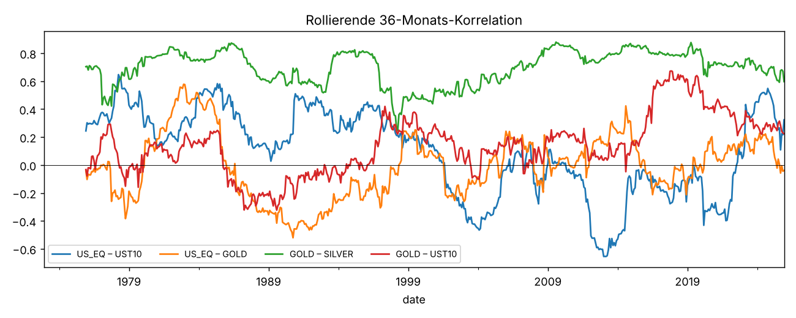
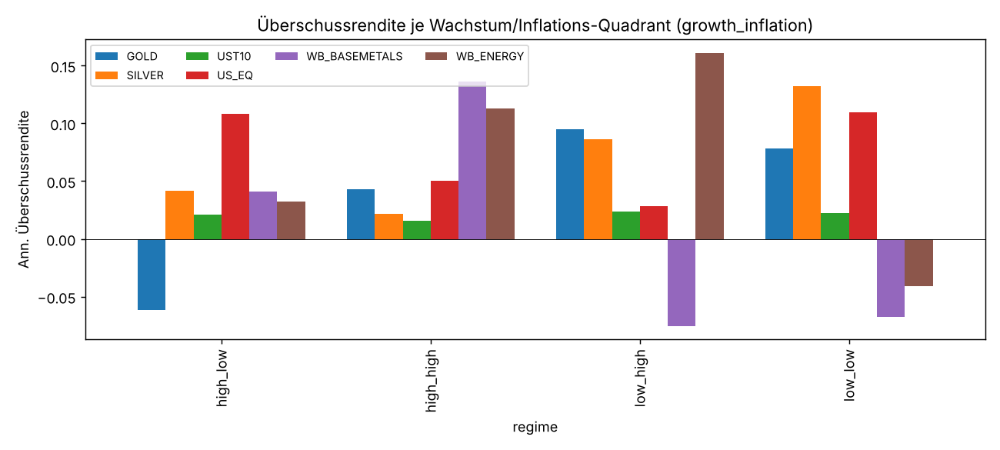
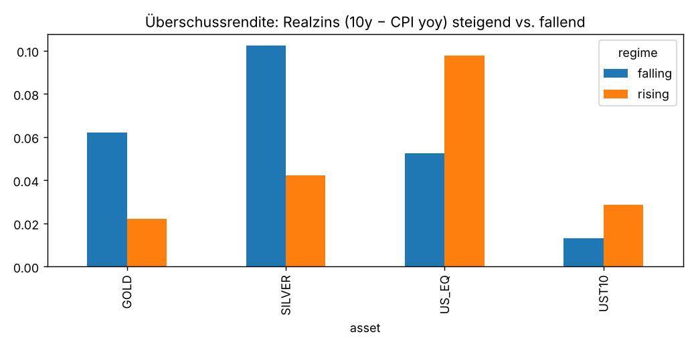
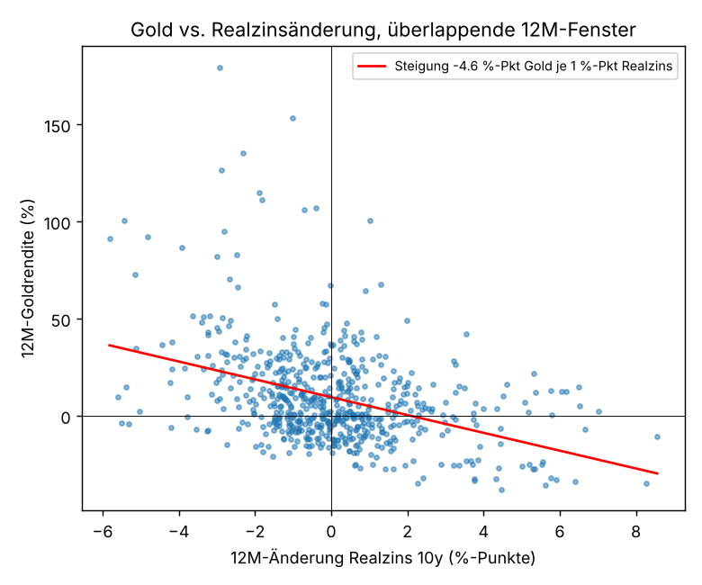
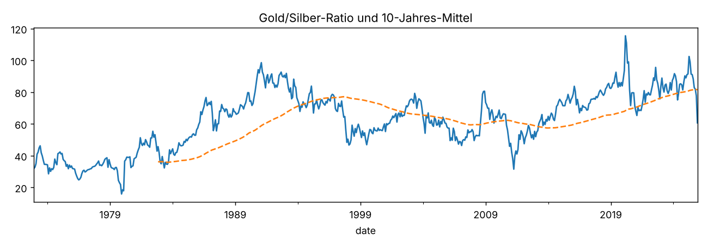
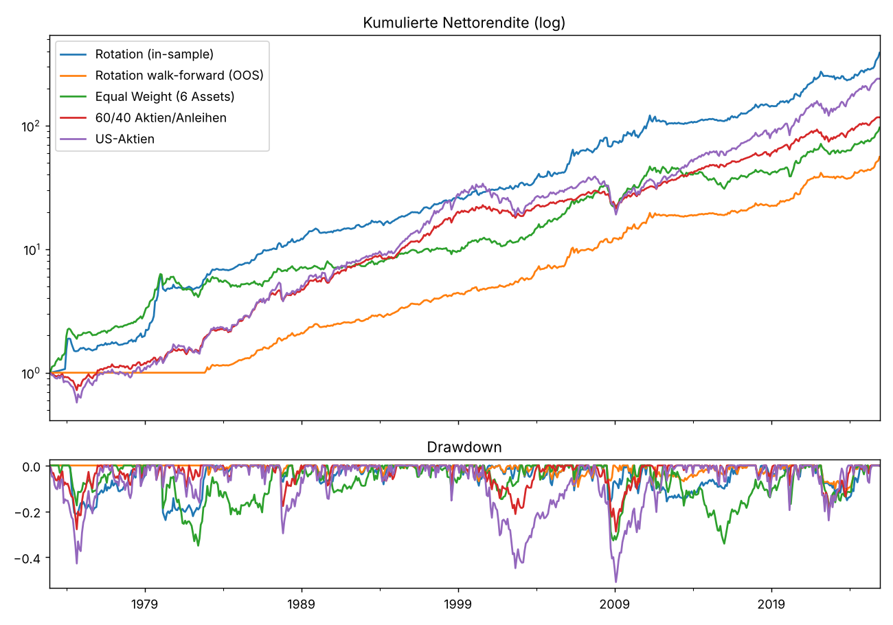
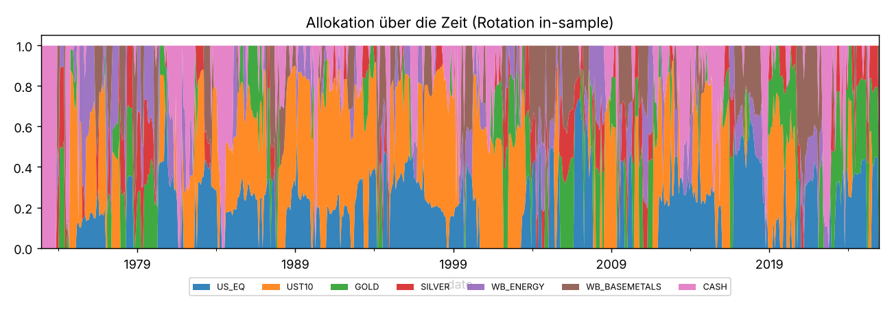
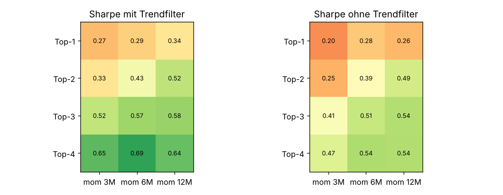

# Cross-Asset Rotation – Auswertung des Langfrist-Panels
Stichprobe: 1972-12 bis 2025-12, 637 Monate, 6 Anlageklassen + Cash (3M-T-Bill).
Alle Renditen monatlich, Monatsende. Überschussrendite = Rendite − T-Bill. Datenquellen und Konstruktion: `data/DATA_SOURCES.md`.

## 1. Deskriptive Statistik (1973–2025)
|  | Start | Ann. Return | Ann. Vol | Sharpe (ex Cash) | Max Drawdown | Skew | Worst Month | Best Month | % Months > 0 |
|---|---|---|---|---|---|---|---|---|---|
| US_EQ | 1973-01 | 0.109 | 0.153 | 0.466 | -0.508 | -0.430 | -0.215 | 0.168 | 0.623 |
| UST10 | 1973-01 | 0.063 | 0.071 | 0.285 | -0.253 | 0.527 | -0.082 | 0.108 | 0.619 |
| GOLD | 1973-01 | 0.083 | 0.196 | 0.276 | -0.618 | 0.779 | -0.224 | 0.288 | 0.531 |
| SILVER | 1973-01 | 0.070 | 0.330 | 0.234 | -0.900 | 0.846 | -0.620 | 0.695 | 0.494 |
| WB_ENERGY | 1973-01 | 0.065 | 0.364 | 0.185 | -0.818 | 8.920 | -0.357 | 1.874 | 0.527 |
| WB_BASEMETALS | 1973-01 | 0.040 | 0.171 | 0.055 | -0.619 | -0.173 | -0.239 | 0.173 | 0.530 |

### Teilperioden
|  | 1973–1984 Ann. Return | 1973–1984 Sharpe | 1985–1999 Ann. Return | 1985–1999 Sharpe | 2000–2012 Ann. Return | 2000–2012 Sharpe | 2013–2025 Ann. Return | 2013–2025 Sharpe |
|---|---|---|---|---|---|---|---|---|
| US_EQ | 0.079 | 0.021 | 0.187 | 0.868 | 0.016 | 0.046 | 0.148 | 0.931 |
| UST10 | 0.070 | -0.152 | 0.100 | 0.664 | 0.071 | 0.732 | 0.009 | -0.099 |
| GOLD | 0.139 | 0.294 | -0.004 | -0.389 | 0.143 | 0.735 | 0.077 | 0.465 |
| SILVER | 0.099 | 0.252 | -0.011 | -0.174 | 0.142 | 0.513 | 0.070 | 0.315 |
| WB_ENERGY | 0.231 | 0.364 | -0.005 | -0.107 | 0.113 | 0.459 | -0.035 | -0.033 |
| WB_BASEMETALS | 0.048 | -0.156 | 0.021 | -0.112 | 0.068 | 0.323 | 0.026 | 0.134 |

## 2. Korrelationen der Monatsrenditen
|  | US_EQ | UST10 | GOLD | SILVER | WB_ENERGY | WB_BASEMETALS |
|---|---|---|---|---|---|---|
| US_EQ | 1.00 | 0.10 | 0.01 | 0.15 | 0.03 | 0.09 |
| UST10 | 0.10 | 1.00 | 0.08 | -0.01 | -0.17 | -0.21 |
| GOLD | 0.01 | 0.08 | 1.00 | 0.72 | 0.15 | 0.16 |
| SILVER | 0.15 | -0.01 | 0.72 | 1.00 | 0.15 | 0.25 |
| WB_ENERGY | 0.03 | -0.17 | 0.15 | 0.15 | 1.00 | 0.18 |
| WB_BASEMETALS | 0.09 | -0.21 | 0.16 | 0.25 | 0.18 | 1.00 |

## 3. Renditen je Makro-Regime
Regime = Trendrichtung über 3 Monate (3M-Durchschnitt heute vs. vor 3 Monaten), um einen Monat verzögert (Publikationslag). Tabellen: annualisierte Überschussrendite; t-Statistik in Klammern-Tabelle darunter. Vorsicht: Regime sind autokorreliert, t-Werte daher optimistisch.

### Wachstum × Inflation (Quadranten)
| asset | high_high (n=158) | high_low (n=139) | low_high (n=157) | low_low (n=177) |
|---|---|---|---|---|
| GOLD | 0.043 | -0.061 | 0.095 | 0.078 |
| SILVER | 0.022 | 0.042 | 0.087 | 0.132 |
| UST10 | 0.016 | 0.021 | 0.023 | 0.022 |
| US_EQ | 0.051 | 0.108 | 0.028 | 0.110 |
| WB_BASEMETALS | 0.136 | 0.041 | -0.075 | -0.068 |
| WB_ENERGY | 0.113 | 0.032 | 0.161 | -0.041 |
t-Statistiken:
| asset | high_high (n=158) | high_low (n=139) | low_high (n=157) | low_low (n=177) |
|---|---|---|---|---|
| GOLD | 0.9 | -1.2 | 1.4 | 1.8 |
| SILVER | 0.3 | 0.5 | 0.7 | 1.8 |
| UST10 | 0.9 | 1.2 | 1.1 | 1.1 |
| US_EQ | 1.2 | 2.7 | 0.6 | 2.9 |
| WB_BASEMETALS | 3.3 | 1.0 | -1.3 | -1.5 |
| WB_ENERGY | 1.6 | 0.5 | 1.0 | -0.6 |

### real_yield
| asset | falling (n=326) | rising (n=305) |
|---|---|---|
| GOLD | 0.062 | 0.022 |
| SILVER | 0.102 | 0.042 |
| UST10 | 0.013 | 0.029 |
| US_EQ | 0.052 | 0.098 |
| WB_BASEMETALS | 0.010 | 0.001 |
| WB_ENERGY | 0.098 | 0.027 |
t-Statistiken:
| asset | falling (n=326) | rising (n=305) |
|---|---|---|
| GOLD | 1.6 | 0.6 |
| SILVER | 1.5 | 0.7 |
| UST10 | 1.0 | 2.0 |
| US_EQ | 1.8 | 3.2 |
| WB_BASEMETALS | 0.3 | 0.0 |
| WB_ENERGY | 1.1 | 0.6 |

### dollar
| asset | falling (n=301) | rising (n=329) |
|---|---|---|
| GOLD | 0.019 | 0.062 |
| SILVER | 0.030 | 0.111 |
| UST10 | 0.002 | 0.038 |
| US_EQ | 0.081 | 0.069 |
| WB_BASEMETALS | 0.071 | -0.058 |
| WB_ENERGY | 0.056 | 0.071 |
t-Statistiken:
| asset | falling (n=301) | rising (n=329) |
|---|---|---|
| GOLD | 0.5 | 1.7 |
| SILVER | 0.5 | 1.8 |
| UST10 | 0.2 | 2.7 |
| US_EQ | 2.9 | 2.2 |
| WB_BASEMETALS | 2.2 | -1.7 |
| WB_ENERGY | 1.0 | 0.9 |

### curve
| asset | falling (n=335) | rising (n=296) |
|---|---|---|
| GOLD | 0.044 | 0.042 |
| SILVER | 0.085 | 0.061 |
| UST10 | 0.010 | 0.032 |
| US_EQ | 0.079 | 0.069 |
| WB_BASEMETALS | 0.047 | -0.041 |
| WB_ENERGY | 0.013 | 0.122 |
t-Statistiken:
| asset | falling (n=335) | rising (n=296) |
|---|---|---|
| GOLD | 1.3 | 1.1 |
| SILVER | 1.5 | 0.8 |
| UST10 | 0.8 | 2.2 |
| US_EQ | 3.0 | 2.0 |
| WB_BASEMETALS | 1.5 | -1.1 |
| WB_ENERGY | 0.3 | 1.3 |

### credit
| asset | falling (n=338) | rising (n=293) |
|---|---|---|
| GOLD | 0.036 | 0.050 |
| SILVER | 0.049 | 0.102 |
| UST10 | 0.027 | 0.014 |
| US_EQ | 0.066 | 0.084 |
| WB_BASEMETALS | 0.034 | -0.027 |
| WB_ENERGY | 0.121 | -0.002 |
t-Statistiken:
| asset | falling (n=338) | rising (n=293) |
|---|---|---|
| GOLD | 1.1 | 1.3 |
| SILVER | 0.8 | 1.4 |
| UST10 | 2.2 | 0.9 |
| US_EQ | 2.4 | 2.5 |
| WB_BASEMETALS | 1.1 | -0.8 |
| WB_ENERGY | 1.5 | -0.0 |

### fedfunds
| asset | falling (n=313) | rising (n=318) |
|---|---|---|
| GOLD | 0.063 | 0.023 |
| SILVER | 0.152 | -0.005 |
| UST10 | 0.037 | 0.004 |
| US_EQ | 0.086 | 0.063 |
| WB_BASEMETALS | 0.006 | 0.005 |
| WB_ENERGY | 0.060 | 0.068 |
t-Statistiken:
| asset | falling (n=313) | rising (n=318) |
|---|---|---|
| GOLD | 1.8 | 0.6 |
| SILVER | 2.4 | -0.1 |
| UST10 | 2.7 | 0.3 |
| US_EQ | 2.9 | 2.1 |
| WB_BASEMETALS | 0.2 | 0.1 |
| WB_ENERGY | 0.7 | 1.5 |

### vix
| asset | high (n=79) | low (n=352) |
|---|---|---|
| GOLD | -0.018 | 0.066 |
| SILVER | 0.024 | 0.100 |
| UST10 | 0.036 | 0.022 |
| US_EQ | 0.155 | 0.072 |
| WB_BASEMETALS | -0.068 | 0.037 |
| WB_ENERGY | -0.010 | 0.051 |
t-Statistiken:
| asset | high (n=79) | low (n=352) |
|---|---|---|
| GOLD | -0.2 | 2.5 |
| SILVER | 0.2 | 2.0 |
| UST10 | 1.1 | 2.2 |
| US_EQ | 1.9 | 3.1 |
| WB_BASEMETALS | -0.7 | 1.4 |
| WB_ENERGY | -0.1 | 1.2 |

### infl_level
| asset | 2-4% (n=279) | <2% (n=144) | >4% (n=212) |
|---|---|---|---|
| GOLD | 0.070 | 0.056 | 0.030 |
| SILVER | 0.064 | 0.177 | 0.022 |
| UST10 | 0.038 | 0.017 | -0.002 |
| US_EQ | 0.075 | 0.184 | -0.010 |
| WB_BASEMETALS | 0.023 | 0.105 | -0.073 |
| WB_ENERGY | -0.028 | 0.153 | 0.134 |
t-Statistiken:
| asset | 2-4% (n=279) | <2% (n=144) | >4% (n=212) |
|---|---|---|---|
| GOLD | 2.1 | 1.2 | 0.5 |
| SILVER | 1.1 | 1.9 | 0.2 |
| UST10 | 2.9 | 0.9 | -0.1 |
| US_EQ | 2.8 | 4.2 | -0.2 |
| WB_BASEMETALS | 0.7 | 2.4 | -1.7 |
| WB_ENERGY | -0.6 | 1.8 | 1.1 |

## 4. Was treibt Gold, Silber & Co.? (OLS, Newey-West t-Werte)
Monatliche Überschussrendite (in %) auf *gleichzeitige* Faktoränderungen (standardisiert, 1 Std.-Abw.). Koeffizient = %-Punkte Monatsrendite je 1 Std.-Abw. Faktoränderung. Die prädiktive Variante (Faktor um 1 Monat verzögert) zeigt, ob die Information *vorher* nutzbar ist.

### Gleichzeitig (erklärend), 1973–2025
| factor | GOLD | SILVER | UST10 | US_EQ | WB_BASEMETALS | WB_ENERGY |
|---|---|---|---|---|---|---|
| Δ Realzins 10y | -0.31 | -0.00 | -3.10 | -0.75 | 0.87 | 0.95 |
| Δ log Dollar | -2.09 | -2.62 | -0.00 | -0.96 | -1.04 | -0.43 |
| Δ CPI yoy | 0.37 | 0.67 | -2.82 | -0.94 | 1.37 | 4.00 |
| Δ Kreditspread | -0.21 | -1.24 | -0.05 | -0.49 | -1.32 | -1.28 |
| Δ Zinskurve | 0.26 | 0.66 | -0.12 | 0.14 | 0.13 | 0.44 |
| Δ IP yoy | -0.08 | 0.13 | -0.02 | -0.02 | 0.24 | -0.31 |
| R² | 0.17 | 0.11 | 0.97 | 0.08 | 0.19 | 0.13 |
t-Statistiken:
| factor | GOLD | SILVER | UST10 | US_EQ | WB_BASEMETALS | WB_ENERGY |
|---|---|---|---|---|---|---|
| Δ Realzins 10y | -0.7 | -0.0 | -41.4 | -2.0 | 2.4 | 1.7 |
| Δ log Dollar | -6.9 | -5.1 | -0.3 | -3.3 | -5.2 | -0.7 |
| Δ CPI yoy | 0.7 | 0.7 | -41.6 | -2.7 | 3.7 | 5.2 |
| Δ Kreditspread | -1.1 | -3.4 | -1.5 | -2.3 | -5.6 | -2.1 |
| Δ Zinskurve | 0.9 | 1.3 | -6.2 | 0.7 | 0.6 | 1.7 |
| Δ IP yoy | -0.3 | 0.3 | -1.0 | -0.1 | 1.8 | -0.5 |

### Prädiktiv (Faktor t−1 → Rendite t)
| factor | GOLD | SILVER | UST10 | US_EQ | WB_BASEMETALS | WB_ENERGY |
|---|---|---|---|---|---|---|
| Δ Realzins 10y | -1.6 | -1.4 | -5.1 | -2.4 | 0.8 | 1.2 |
| Δ log Dollar | 0.6 | 0.2 | 0.3 | 0.1 | -5.7 | -2.1 |
| Δ CPI yoy | -0.4 | -0.9 | -6.2 | -3.2 | 1.4 | 2.8 |
| Δ Kreditspread | 0.7 | -0.5 | 1.2 | -0.1 | -3.3 | 0.2 |
| Δ Zinskurve | 1.6 | 0.8 | -1.0 | 1.6 | -0.0 | 0.6 |
| Δ IP yoy | -0.9 | -0.3 | 1.0 | 1.5 | 1.8 | -0.3 |

### Gleichzeitig inkl. VIX, 1990–2025 (t-Statistiken)
| factor | GOLD | SILVER | UST10 | US_EQ | WB_BASEMETALS | WB_ENERGY |
|---|---|---|---|---|---|---|
| Δ Realzins 10y | -1.8 | 0.9 | -63.3 | 0.7 | 2.5 | 3.2 |
| Δ log Dollar | -6.9 | -5.0 | 1.1 | -4.0 | -4.9 | -5.0 |
| Δ CPI yoy | -1.1 | 0.7 | -65.7 | 0.8 | 3.2 | 5.5 |
| Δ Kreditspread | -0.1 | -2.0 | 2.1 | -1.8 | -6.2 | -2.9 |
| Δ Zinskurve | -0.1 | -0.1 | -1.1 | -0.6 | 0.3 | -0.3 |
| Δ IP yoy | -0.2 | 0.6 | 0.1 | -0.1 | 0.9 | -0.2 |
| Δ log VIX | 2.8 | -0.7 | -0.3 | -14.6 | 0.4 | 0.1 |

### 12-Monats-Horizont (Jahres-Überschussrendite in % je 1 Std.-Abw. der 12M-Faktoränderung; überlappende Fenster)
| factor | GOLD | SILVER | UST10 | US_EQ | WB_BASEMETALS | WB_ENERGY |
|---|---|---|---|---|---|---|
| Δ12 Realzins 10y | 0.9 | 0.7 | -16.5 | -5.6 | 7.2 | 6.8 |
| Δ12 log Dollar | -7.4 | -6.0 | -0.0 | -1.0 | -8.3 | 2.7 |
| Δ12 CPI yoy | 10.6 | 14.1 | -17.0 | -6.6 | 14.8 | 40.3 |
| Δ12 Kreditspread | 1.6 | -4.8 | 0.2 | -6.7 | -8.1 | -3.0 |
| Δ12 IP yoy | -5.4 | -5.3 | 0.5 | 2.7 | 2.9 | -1.6 |
| R² | 0.3 | 0.1 | 1.0 | 0.3 | 0.5 | 0.5 |
t-Statistiken (Newey-West, 12 Lags):
| factor | GOLD | SILVER | UST10 | US_EQ | WB_BASEMETALS | WB_ENERGY |
|---|---|---|---|---|---|---|
| Δ12 Realzins 10y | 0.2 | 0.1 | -37.5 | -2.1 | 1.6 | 1.3 |
| Δ12 log Dollar | -4.1 | -1.7 | -0.3 | -0.7 | -4.0 | 0.7 |
| Δ12 CPI yoy | 1.6 | 1.1 | -45.6 | -2.5 | 3.6 | 4.6 |
| Δ12 Kreditspread | 0.6 | -1.4 | 1.2 | -4.0 | -5.8 | -0.8 |
| Δ12 IP yoy | -2.2 | -1.3 | 2.2 | 1.5 | 2.3 | -0.3 |

### Welcher Kanal wann? Korrelation der 12M-Rendite mit 12M-Faktoränderungen je Teilperiode
Der 'Realzins' (nominal − CPI) vermischt zwei Kanäle: In den 1970/80ern reagierte Gold auf *Inflation*, seit 2006 auf *Nominalzinsen* und den *Dollar*. Die Dollar-Beziehung ist über alle Perioden stabil negativ.
|  | Gold: Δ12 Realzins (ex post) | Gold: Δ12 Nominalzins 10y | Gold: Δ12 CPI yoy | Gold: Δ12 log Dollar | Silber: Δ12 Realzins (ex post) | Silber: Δ12 log Dollar |
|---|---|---|---|---|---|---|
| 1973–1989 | -0.59 | 0.16 | 0.65 | -0.28 | -0.44 | -0.07 |
| 1990–2005 | -0.10 | 0.10 | 0.19 | -0.53 | 0.17 | -0.19 |
| 2006–2025 | -0.20 | -0.31 | 0.09 | -0.49 | -0.18 | -0.61 |
| 2013–2025 | -0.02 | -0.42 | -0.15 | -0.33 | -0.05 | -0.50 |
| 1973–2025 | -0.39 | 0.08 | 0.43 | -0.32 | -0.29 | -0.21 |

## 5. Information Coefficients der Asset-Features
Spearman-Rangkorrelation zwischen Feature zum Monatsende t und Überschussrendite im Monat t+1 über die 6 Assets. IC > 0 = Feature ordnet richtig.
**Vorsicht:** Die World-Bank-Rohstoffindizes sind Monats*durchschnitte*. Durchschnittsbildung erzeugt künstliche positive Autokorrelation (Working-Effekt), die 1-Monats-Features (`rev_1m`, `mom_12m_noskip`) überzeichnet. Deshalb nutzt das Modell Momentum mit 1-Monats-Skip; die zweite Tabelle wiederholt die Rechnung nur mit echten Monatsendkursen (Aktien, Treasury, Gold, Silber).
| feature | months | mean_IC | std_IC | t_stat | IC>0 |
|---|---|---|---|---|---|
| mom_12m_noskip | 624.000 | 0.113 | 0.507 | 5.544 | 0.591 |
| rev_1m | 635.000 | 0.082 | 0.495 | 4.166 | 0.565 |
| trend_10m | 627.000 | 0.080 | 0.516 | 3.889 | 0.569 |
| mom_12m | 623.000 | 0.069 | 0.511 | 3.362 | 0.568 |
| mom_6m | 629.000 | 0.060 | 0.507 | 2.978 | 0.542 |
| rel_mom_6m | 629.000 | 0.060 | 0.507 | 2.978 | 0.542 |
| mom_3m | 632.000 | 0.009 | 0.522 | 0.425 | 0.521 |
| lt_rev_36m | 600.000 | -0.002 | 0.516 | -0.117 | 0.475 |
| inv_vol | 624.000 | -0.005 | 0.503 | -0.224 | 0.495 |

Nur Monatsend-Assets (4 Assets, daher kleinere ICs erwartbar):
| feature | months | mean_IC | std_IC | t_stat | IC>0 |
|---|---|---|---|---|---|
| mom_12m_noskip | 624.000 | 0.128 | 0.660 | 4.829 | 0.558 |
| mom_12m | 623.000 | 0.096 | 0.655 | 3.660 | 0.522 |
| mom_6m | 629.000 | 0.079 | 0.648 | 3.077 | 0.515 |
| rel_mom_6m | 629.000 | 0.079 | 0.648 | 3.077 | 0.515 |
| trend_10m | 627.000 | 0.063 | 0.651 | 2.418 | 0.506 |
| lt_rev_36m | 600.000 | 0.058 | 0.662 | 2.134 | 0.490 |
| rev_1m | 635.000 | 0.030 | 0.654 | 1.142 | 0.488 |
| mom_3m | 632.000 | 0.008 | 0.660 | 0.289 | 0.481 |
| inv_vol | 624.000 | -0.011 | 0.667 | -0.420 | 0.466 |

Top-Tercil minus Bottom-Tercil nach 12M-Momentum (6 Assets): 8.3% p.a., Sharpe 0.36, 623 Monate.

## 6. Gold/Silber-Ratio: Mean Reversion?
AR(1) auf log(Gold/Silber): φ = 0.976, Halbwertszeit ≈ 29 Monate, t(ρ−1) = -1.79 (n=636). Zum Vergleich: ADF-kritischer Wert 5 % ≈ −2.87.
Vorwärts-12M-Rendite Silber minus Gold je Quintil der Ratio-Abweichung vom 10-Jahres-Mittel (Q5 = Ratio ungewöhnlich hoch = Silber billig; Quintile expandierend, ohne Look-ahead):
| q | n | mean_fwd | median_fwd | hit |
|---|---|---|---|---|
| Q1 | 131.000 | -0.037 | -0.047 | 0.321 |
| Q2 | 85.000 | -0.015 | -0.064 | 0.424 |
| Q3 | 107.000 | 0.081 | -0.008 | 0.458 |
| Q4 | 127.000 | -0.026 | -0.054 | 0.299 |
| Q5 | 57.000 | 0.016 | 0.015 | 0.526 |

## 7. Rotationsstrategie
Signal: Composite aus z-Scores (Momentum 3/6/12M, Trend, inverse Vol) → Top-3, inverse-Vol-gewichtet, Trendfilter (unter 10M-Schnitt → Cash), 15 bp Kosten auf Turnover. Varianten: ohne/mit Regime-Tilts, Walk-forward (Parameter jährlich auf Vergangenheit gewählt).

### Kennzahlen (1972-12 – 2025-12)
Sharpe auf Überschussrendite über T-Bills (wichtig: T-Bills brachten 1973–2025 im Schnitt 4.5 % p.a.).
|  | Ann. Return | Ann. Vol | Sharpe (ex Cash) | Max Drawdown | Calmar | Hit Rate | Ann. Turnover |
|---|---|---|---|---|---|---|---|
| Rotation (in-sample) | 0.119 | 0.135 | 0.570 | -0.238 | 0.500 | 0.647 | 2.657 |
| Rotation + Regime-Tilts | 0.123 | 0.137 | 0.590 | -0.238 | 0.515 | 0.651 | 2.775 |
| Rotation ohne Trendfilter | 0.119 | 0.140 | 0.558 | -0.265 | 0.449 | 0.628 |  |
| Rotation walk-forward (OOS) | 0.098 | 0.080 | 0.772 | -0.108 | 0.909 | 0.640 |  |
| Rotation nur Monatsend-Assets (Top-2) | 0.106 | 0.164 | 0.429 | -0.363 | 0.293 | 0.630 |  |
| Equal Weight (6 Assets) | 0.090 | 0.125 | 0.398 | -0.349 | 0.258 | 0.599 |  |
| 60/40 Aktien/Anleihen | 0.094 | 0.099 | 0.514 | -0.288 | 0.326 | 0.645 |  |
| US-Aktien | 0.109 | 0.153 | 0.466 | -0.508 | 0.214 | 0.623 |  |
| Gold | 0.083 | 0.196 | 0.276 | -0.618 | 0.134 | 0.531 |  |
| T-Bills | 0.045 | 0.010 |  | 0.000 |  | 1.000 |  |

### Annualisierte Rendite je Jahrzehnt
|  | Strategie | EW | 60/40 | OOS | T-Bills | months |
|---|---|---|---|---|---|---|
| 1970s | 0.264 | 0.285 | 0.038 |  | 0.070 | 85.000 |
| 1980s | 0.108 | 0.023 | 0.160 | 0.137 | 0.092 | 120.000 |
| 1990s | 0.070 | 0.049 | 0.141 | 0.069 | 0.050 | 120.000 |
| 2000s | 0.115 | 0.101 | 0.024 | 0.118 | 0.028 | 120.000 |
| 2010s | 0.062 | 0.041 | 0.098 | 0.053 | 0.006 | 120.000 |
| 2020s | 0.163 | 0.132 | 0.089 | 0.146 | 0.028 | 72.000 |

### Walk-forward: wie oft welche Parameter gewählt wurden
Erstes Trainingsfenster 120 Monate, Neuwahl jährlich, Kriterium Sharpe (ex Cash) auf allen bisherigen Daten; OOS-Periode 1982-12 bis 2025-12.
| top_n | trend_filter | Jahre gewählt |
|---|---|---|
| 4 | True | 44 |

### Durchschnittliche Allokation (in-sample)
|  | avg_weight |
|---|---|
| US_EQ | 18.8% |
| UST10 | 27.4% |
| GOLD | 12.0% |
| SILVER | 7.0% |
| WB_ENERGY | 9.3% |
| WB_BASEMETALS | 11.4% |
| CASH | 14.1% |

## 8. Parameter-Sensitivität (Sharpe ex Cash, netto, in-sample, reines Momentum mit 1M-Skip)
Mit Trendfilter:
|  | mom 3M | mom 6M | mom 12M |
|---|---|---|---|
| Top-1 | 0.27 | 0.29 | 0.34 |
| Top-2 | 0.33 | 0.43 | 0.52 |
| Top-3 | 0.52 | 0.57 | 0.58 |
| Top-4 | 0.65 | 0.69 | 0.64 |
Ohne Trendfilter:
|  | mom 3M | mom 6M | mom 12M |
|---|---|---|---|
| Top-1 | 0.20 | 0.28 | 0.26 |
| Top-2 | 0.25 | 0.39 | 0.49 |
| Top-3 | 0.41 | 0.51 | 0.54 |
| Top-4 | 0.47 | 0.54 | 0.54 |

## 9. Datenabdeckung
| file | series | start | end | n |
|---|---|---|---|---|
| assets_monthly | US_EQ | 1959-12-31 | 2025-12-31 | 793 |
| assets_monthly | GOLD | 1960-01-31 | 2025-12-31 | 792 |
| assets_monthly | SILVER | 1968-01-31 | 2025-12-31 | 696 |
| assets_monthly | TBILL | 1959-12-31 | 2025-12-31 | 793 |
| assets_monthly | UST10 | 1959-12-31 | 2025-12-31 | 793 |
| assets_monthly | UST5 | 1959-12-31 | 2025-12-31 | 793 |
| assets_monthly | UST1 | 1959-12-31 | 2025-12-31 | 793 |
| assets_monthly | WB_ENERGY | 1960-01-31 | 2025-12-31 | 792 |
| assets_monthly | WB_BASEMETALS | 1960-01-31 | 2025-12-31 | 792 |
| assets_monthly | WB_METALS | 1960-01-31 | 2025-12-31 | 792 |
| assets_monthly | WB_AGRI | 1960-01-31 | 2025-12-31 | 792 |
| assets_monthly | WB_NONENERGY | 1960-01-31 | 2025-12-31 | 792 |
| assets_monthly | WB_TOTAL | 1960-01-31 | 2025-12-31 | 792 |
| assets_monthly | WB_PRECIOUS | 1960-01-31 | 2025-12-31 | 792 |
| assets_monthly | WB_OIL | 1960-01-31 | 2025-12-31 | 792 |
| assets_monthly | WB_COPPER | 1960-01-31 | 2025-12-31 | 792 |
| assets_monthly | WB_PLATINUM | 1960-01-31 | 2025-12-31 | 792 |
| assets_monthly | WB_GOLD_AVG | 1960-01-31 | 2025-12-31 | 792 |
| assets_monthly | WB_SILVER_AVG | 1960-01-31 | 2025-12-31 | 792 |
| assets_monthly | SHILLER_SP500_AVG | 1959-12-31 | 2025-12-31 | 793 |
| macro_monthly | INDPRO | 1959-01-31 | 2026-08-31 | 812 |
| macro_monthly | CAPUTIL | 1959-01-31 | 2026-08-31 | 812 |
| macro_monthly | PAYEMS | 1959-01-31 | 2026-08-31 | 812 |
| macro_monthly | UNRATE | 1959-01-31 | 2026-08-31 | 811 |
| macro_monthly | CLAIMS | 1959-01-31 | 2026-08-31 | 812 |
| macro_monthly | HOUST | 1959-01-31 | 2026-08-31 | 812 |
| macro_monthly | PERMIT | 1960-01-31 | 2026-08-31 | 800 |
| macro_monthly | DURGOODS_ORD | 1959-01-31 | 2026-08-31 | 812 |
| macro_monthly | CONSGOODS_ORD | 1992-02-29 | 2026-07-31 | 414 |
| macro_monthly | RETAIL | 1959-01-31 | 2026-08-31 | 812 |
| macro_monthly | REAL_INCOME | 1959-01-31 | 2026-08-31 | 812 |
| macro_monthly | HOURS_MFG | 1959-01-31 | 2026-08-31 | 812 |
| macro_monthly | UMCSENT | 1959-05-31 | 2026-08-31 | 658 |
| macro_monthly | CPI | 1959-01-31 | 2026-08-31 | 811 |
| macro_monthly | CPI_CORE | 1959-01-31 | 2026-08-31 | 811 |
| macro_monthly | PCE | 1959-01-31 | 2026-08-31 | 812 |
| macro_monthly | PPI_METALS | 1959-01-31 | 2026-08-31 | 812 |
| macro_monthly | OIL_FRED | 1959-01-31 | 2026-08-31 | 812 |
| macro_monthly | M2 | 1959-01-31 | 2026-08-31 | 812 |
| macro_monthly | BUSLOANS | 1959-01-31 | 2026-08-31 | 812 |
| macro_monthly | FEDFUNDS | 1959-01-31 | 2026-08-31 | 812 |
| macro_monthly | TB3M | 1959-01-31 | 2026-08-31 | 812 |
| macro_monthly | TB6M | 1959-01-31 | 2026-08-31 | 812 |
| macro_monthly | GS1 | 1959-01-31 | 2026-08-31 | 812 |
| macro_monthly | GS5 | 1959-01-31 | 2026-08-31 | 812 |
| macro_monthly | GS10 | 1959-01-31 | 2026-08-31 | 812 |
| macro_monthly | AAA | 1959-01-31 | 2026-08-31 | 812 |
| macro_monthly | BAA | 1959-01-31 | 2026-08-31 | 812 |
| macro_monthly | USD_TW_AVG | 1973-01-31 | 2026-08-31 | 644 |
| macro_monthly | USDCHF | 1959-01-31 | 2026-08-31 | 812 |
| macro_monthly | USDJPY | 1959-01-31 | 2026-08-31 | 812 |
| macro_monthly | GBPUSD | 1959-01-31 | 2026-08-31 | 812 |
| macro_monthly | SP_DIVYIELD | 1959-01-31 | 2026-06-30 | 810 |
| macro_monthly | SP_PE | 1959-01-31 | 2026-07-31 | 811 |
| macro_monthly | VIX_AVG | 1962-07-31 | 2026-08-31 | 770 |
| macro_monthly | VIX | 1990-01-31 | 2026-08-31 | 440 |
| macro_monthly | HY_OAS | 1996-12-31 | 2021-03-31 | 292 |
| macro_monthly | USD_IDX | 1973-01-31 | 2025-12-31 | 636 |
| macro_monthly | SHILLER_CAPE | 1959-01-31 | 2023-09-30 | 777 |
| macro_monthly | SHILLER_EPS | 1959-01-31 | 2023-06-30 | 774 |
| macro_monthly | CPI_YOY | 1960-01-31 | 2026-08-31 | 799 |
| macro_monthly | CPI_CORE_YOY | 1960-01-31 | 2026-08-31 | 799 |
| macro_monthly | CPI_3M_ANN | 1959-04-30 | 2026-08-31 | 807 |
| macro_monthly | PCE_YOY | 1960-01-31 | 2026-08-31 | 800 |
| macro_monthly | INDPRO_YOY | 1960-01-31 | 2026-08-31 | 800 |
| macro_monthly | INDPRO_3M_ANN | 1959-04-30 | 2026-08-31 | 809 |
| macro_monthly | PAYEMS_YOY | 1960-01-31 | 2026-08-31 | 800 |
| macro_monthly | UNRATE_CHG12 | 1960-01-31 | 2026-08-31 | 799 |
| macro_monthly | M2_YOY | 1960-01-31 | 2026-08-31 | 800 |
| macro_monthly | REAL_GS10 | 1960-01-31 | 2026-08-31 | 799 |
| macro_monthly | REAL_FF | 1960-01-31 | 2026-08-31 | 799 |
| macro_monthly | CURVE_10Y3M | 1959-01-31 | 2026-08-31 | 812 |
| macro_monthly | CURVE_10Y1Y | 1959-01-31 | 2026-08-31 | 812 |
| macro_monthly | CREDIT_BAA_AAA | 1959-01-31 | 2026-08-31 | 812 |
| macro_monthly | CREDIT_BAA_GS10 | 1959-01-31 | 2026-08-31 | 812 |
| macro_monthly | GOLD_SILVER_RATIO | 1968-01-31 | 2025-12-31 | 696 |
